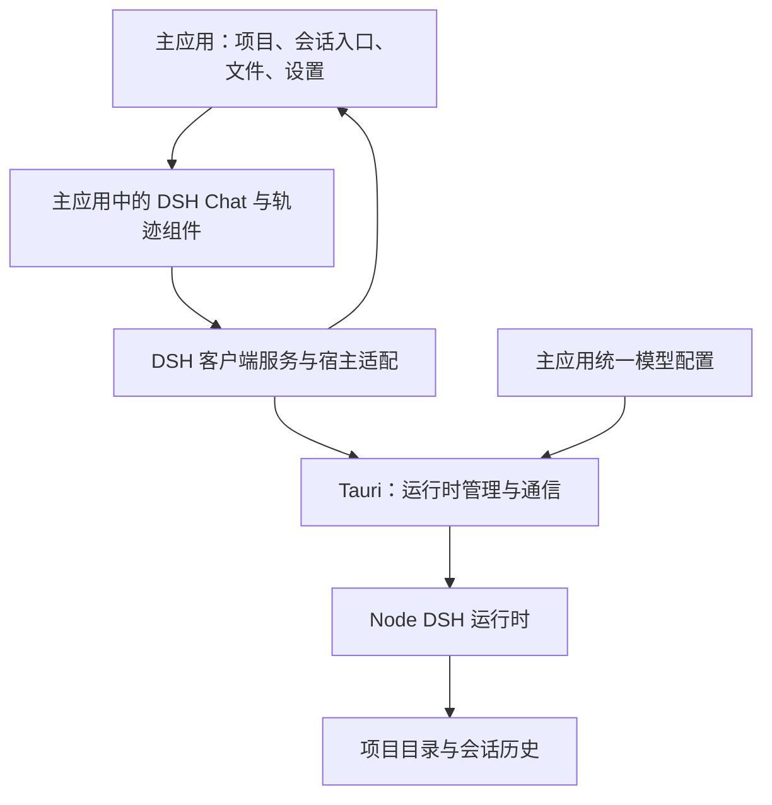

# DSH 组件融入主应用建议方案

## 一、建议结论

采用 **“复用 DSH 原组件，改造后接入主应用前端”** 的方案。

保留 DSH 的运行时、会话协议，以及 Chat、轨迹、输入框和工具展示的实现；由主应用承担项目导航、会话管理入口、文件浏览、模型配置和设置。

最终 Chat 与轨迹直接渲染在主应用页面中，保留原有视觉和交互，替换当前独立子 WebView。

**这是组件移植和适配，开发量介于内嵌与完整重写之间。**

---

## 二、最终产品形态

### 2.1 项目与会话

2026-10-15 扩展：Workspace 页面也可直接使用 DSH 聊天，工作目录绑定 Workspace 根目录，会话在助手面板显示并与各 Project 隔离；项目会话仍走内容 Tab。当前契约与验证见 [Workspace 聊天工作包](workspace-dsh-chat.md)。本包暂缓记忆能力。

| 主应用概念 | DSH 对应关系 |
|---|---|
| 项目 | DSH workspace |
| 项目目录 | 助手实际工作目录 |
| 项目中的会话 | 对应 workspace 下的 DSH session |
| 主应用模型配置 | DSH 实际使用的 Provider/model |
| 主应用助手设置 | DSH 的交互及执行设置 |
| 主应用插件管理 | DSH Plugin 配置与管理 |

具体行为：

- 进入项目后，显示该项目的会话列表。
- 可以新建、切换、继续和删除会话。
- 切换项目时，同时切换会话列表和助手上下文。
- 项目会话历史独立保存。
- 默认共享主应用的模型配置、助手设置和插件配置。
- 无须登录，也不出现另一套账户或模型配置页面。

### 2.2 界面职责

**主应用负责：**

- 项目选择与导航。
- 会话列表和会话操作入口。
- 助手区域的展开、收起和布局。
- 项目文件浏览及预览。
- 模型配置、助手设置和插件管理。

**复用的 DSH 组件负责：**

- Chat 消息展示。
- 输入框及发送、停止交互。
- 流式输出、运行状态、工具调用卡片。
- Chat 与轨迹视图切换。
- 轨迹时间线、记录详情、输入输出检查。
- 历史分页、折叠、滚动跟随等交互。

---

## 三、复用策略

### 3.1 已确认的技术基础

当前固定版本中，DSH 的 UI 使用 React，并已拆分为以下模块：

| 模块 | 用途 |
|---|---|
| `ui-conversation` | 对话组装、输入状态、共享对话外壳 |
| `ui-chat` | Chat 消息及运行过程展示 |
| `ui-trajectory` | 轨迹、时间线和记录检查 |
| `ui-session` | 会话与组件之间的状态绑定 |
| `ui-renderer`、`ui-slots` | 组件注册、渲染和扩展 |
| UI primitives 等依赖 | 基础控件及视觉实现 |

这些模块依赖 DSH 的客户端服务和注册机制。**不能简单复制两个组件文件就完成接入。**

已检查的相关包使用 MIT 许可；移植时需要保留版权、许可和来源记录，并核对完整依赖的许可。

### 3.2 推荐复用粒度

保留一组能完整工作的对话模块，包括：

- Chat 与轨迹的视图。
- 输入框和共享对话布局。
- 原有事件组装、状态绑定和历史分页。
- 消息、工具结果、Markdown、代码及图片展示所需组件。

改造重点放在外部连接处：

- 当前项目和会话由主应用提供。
- 模型配置由主应用提供。
- 文件链接交给主应用文件预览。
- 设置操作交给主设置面板。
- 页面布局和组件生命周期由主应用控制。

这样可以保留原有消息与轨迹行为，减少重新实现后产生的差异。

### 3.3 源码与构建方式

建议将需要改造的上游源码纳入一个独立的前端包，例如：

```text
packages/dsh-ui/
  upstream/       需要复用的上游源码
  adapters/       主应用接入代码
  styles/         样式入口与必要适配
  provenance.json
  LICENSE
```

要求：

- 固定来源版本和提交。
- 记录上游文件及本地修改。
- 使用正常的前端构建方式接入主应用。
- 保留上游组件注册机制中真正需要的部分。
- 尽量消除对 `window.__ModuleLoader__` 等独立网页启动机制的依赖。
- 同一组件树使用统一的 React 实例。

目前主应用使用 React 19，上游声明的开发依赖是 React 18。兼容性需要通过实际组件运行验证，不能仅凭同为 React 就认定可直接使用。

---

## 四、目标架构



### 4.1 后端保持复用

保留已有接入中的有效部分：

- DSH Node 运行时启动与关闭。
- 项目与 workspace、工作目录的映射。
- 项目会话持久化。
- 主应用模型配置与密钥传递。
- 网络及代理配置。
- 运行时打包与依赖校验。

这些工作不会因 UI 移植而失效。

### 4.2 客户端状态保持统一

Chat 与轨迹应使用同一个 DSH 会话绑定和事件源。

主应用保存项目选择、会话选择、面板布局等状态；DSH 客户端负责会话内容和执行状态，避免双方各保存一套完整消息记录。

发送、停止、历史加载及轨迹检查继续沿用 DSH 原有语义。

### 4.3 通信接入

建议使用 **Tauri 承载的通信适配**，连接主应用页面中的 DSH 客户端与本地运行时。

当前 DSH 的浏览器接口包含 HTTP RPC 和 WebSocket 多路复用流。其浏览器认证还限制请求来源，因此主应用页面不能直接把原网页连接地址换过去就认定接通。

实施顺序：

1. 验证 DSH 已有的自定义通信载体接缝。
2. 接通普通请求、事件流、取消及必要的双向消息。
3. 接通附件上传和读取。
4. 保留 DSH 客户端对连接恢复及会话重新绑定的处理。

原生侧负责运行时凭据和调用归属；前端不获取模型密钥。

**不用能力较窄的 stdio SDK 替换完整客户端协议**，否则会话管理、历史和轨迹可能需要重新补齐。

---

## 五、主应用融合细节

### 5.1 项目切换与运行生命周期

必须明确以下行为：

- 当前项目只能操作自己的会话。
- 项目切换后，旧项目的延迟响应不能写入新项目界面。
- 关闭助手面板只卸载或隐藏界面，不能顺带丢失历史。
- 执行期间切换项目，不能静默终止任务。

已有实现若采用“切项目就替换运行时”，建议第一版在任务执行时给出明确提示：停止任务后再切换。支持多个项目同时执行可作为后续独立能力。

### 5.2 文件浏览和引用

文件能力统一进入主应用：

- Chat 中点击项目文件链接，打开主应用预览。
- 轨迹中的文件导航复用同一入口。
- 主文件区可以将文件引用插入助手输入框。
- 目录内文件引用与外部附件上传采用各自真实语义，避免只有文件名却没有内容。
- 路径解析以该会话所属项目为准，并校验实际访问范围。
- 文件刷新不能对每个流式消息块执行一次；按工具完成或运行结束等实际变化更新。

初期只接入文件浏览、预览、打开和引用，不顺带增加重命名、删除等文件管理功能。

### 5.3 设置与插件

主设置面板增加助手相关内容：

- 对话显示和交互设置。
- 必要的执行设置。
- 插件列表及启用、停用、配置入口。

模型设置继续使用现有统一页面。

优先复用 DSH 可独立使用的设置表单；依赖原完整页面外壳的部分，改为主应用表单调用对应服务。

共享插件配置时，还要保证配置变更影响实际运行时，不能只更新界面。若某项变更必须重启，应明确展示生效时机。

### 5.4 视觉与交互

保留 DSH 原有的：

- 消息排版、间距与代码展示。
- 工具卡片、过程折叠及状态表现。
- 轨迹时间线和详情检查。
- 输入框及 Chat/轨迹切换方式。

接入主应用的：

- 外层尺寸与布局。
- 主题、语言和字体配置。
- 弹窗、菜单、提示层及焦点管理。
- 快捷键与文件预览入口。

样式需要限定作用范围，避免 DSH 的全局规则影响主应用。上游弹窗使用 Portal 时，还需验证挂载位置和样式范围。

对修改过的有界滚动列表，执行主应用的边缘渐变规范；展开、收起等变化遵循连续过渡和 reduced-motion。

---

## 六、分阶段实施

| 阶段 | 交付内容 | 通过条件 |
|---|---|---|
| 0：技术验证 | 主页面直接渲染原组件，接通最小真实会话 | 同一会话可发送、流式展示、停止，并切换 Chat/轨迹 |
| 1：组件包整理 | 固定源码、依赖、构建及样式边界 | 主应用可稳定构建，组件不依赖独立网页外壳 |
| 2：会话与运行接入 | 项目绑定、历史、切换、连接生命周期 | 重开可恢复历史，项目间无会话串用 |
| 3：产品融合 | 文件、设置、插件、主题和快捷键 | 所有入口在主应用中可用 |
| 4：替换与收口 | 移除旧承载方式，完成集中验收 | 主助手使用新组件，打包运行正常 |

### 阶段 0 是关键

先用原 Chat、轨迹和输入框跑通一条完整真实路径，确认：

- React 兼容性。
- 必要客户端服务能否独立组装。
- 通信载体是否覆盖所需能力。
- 样式及弹窗能否融入主页面。

这些验证通过后，再扩大移植范围。当前内嵌界面可作为视觉与行为对照，最终验收后再清理。

---

## 七、验收与验证

### 核心功能

- 新建、切换、继续、删除项目会话。
- 流式回答、多轮对话、工具执行和停止。
- 停止或失败后仍能继续发送。
- 重启应用后恢复历史。
- Chat 与轨迹展示同一次执行的真实记录。
- 历史分页、长内容和轨迹检查正常。

### 项目与配置

- 项目 A、B 的列表和事件不串用。
- 实际工作目录与项目目录一致。
- 使用主应用配置的模型与网络设置。
- 界面及日志不暴露模型密钥。
- 插件配置变更按声明的时机生效。

### 融合体验

- 文件链接打开主应用预览。
- 输入框焦点、快捷键、菜单和弹窗正常。
- 流式输出跟随底部；用户上滚时不被强制拉回。
- 深浅主题、窄面板及展开状态正常。
- 对照同一组会话数据检查原界面与移植后的显示差异。

验证先覆盖受影响模块，收口时集中执行构建、运行集成与界面验收。确定性测试模型用于可重复验证，真实模型验证单独记录。

---

## 八、范围与主要风险

### 第一版包含

- 原 Chat、轨迹及必要组件的移植。
- 项目内会话与目录绑定。
- 统一模型配置。
- 主文件浏览与预览连接。
- 主设置中的助手和插件管理。
- 替换现有 Pi 对话入口及内嵌 DSH 承载方式。

### 第一版暂不包含

- 旧 Pi 历史转换。
- 多项目同时执行。
- 助手直接修改笔记、待办等业务数据库。
- Office/PPT 等完整产品能力。
- 与对话替换无关的后台 Pi 任务迁移。

业务数据访问以后可以接入主应用已有服务和权限流程，避免绕过数据约束直接操作数据库。

### 主要风险与处理

| 风险 | 处理 |
|---|---|
| 上游模块依赖较多 | 移植完整必要依赖集合，先验证最小会话 |
| React 版本差异 | 统一运行实例，验证组件与编辑器兼容性 |
| 通信适配缺少流或附件能力 | 阶段 0 验证完整交互所需协议 |
| 样式、Portal、快捷键冲突 | 限定样式范围，接入主应用宿主能力 |
| 上游更新导致本地修改难同步 | 固定版本、记录来源、集中管理适配修改 |

**最终建议：保留当前运行时和项目接入成果，将后续 UI 工作转向原组件移植。这样可以尽量保留 DSH 的显示效果，同时让文件、设置、导航和交互真正融入主应用。**