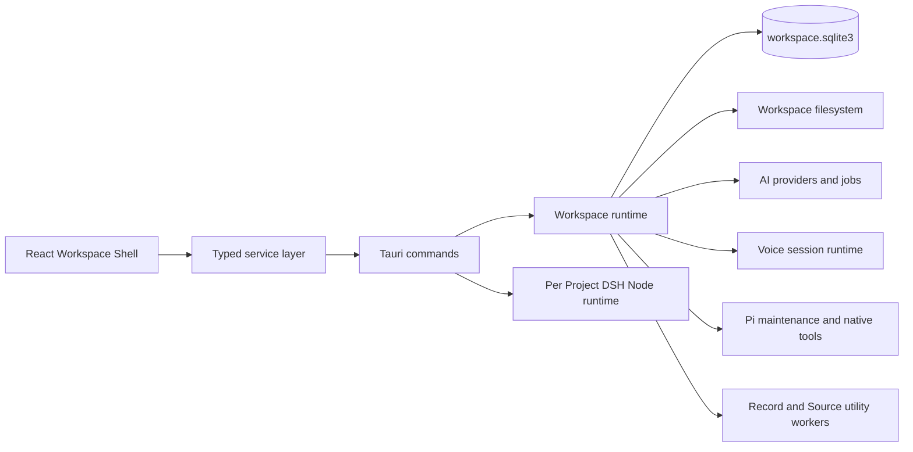

# Project Mind System Design

状态：当前正式基线

更新时间：2026-10-14

代码依据：当前工作分支；接入与验收边界见[未完成事项](remaining-work.md)。

## 1. 架构摘要

Project Mind 是 `Tauri 2 + React 19 + TypeScript + SQLite` 的本地桌面应用。



核心边界：

1. React 负责页面、编辑现场与即时反馈。
2. Typed service layer 是前端访问 Tauri command 的边界。
3. Workspace runtime 持有当前 Workspace 的数据库、文件、保存和录音生命周期。
4. SQLite 与 Workspace 文件系统共同构成本地事实来源。

## 2. Workspace 与持久化

```text
<workspace-root>/
  .project-mind/
    workspace.json
    workspace.sqlite3
    cache/ai/
    logs/
    tmp/
  <Project A>/
    .project-mind/embedded-note-assets/
```

- 当前数据库 schema 为 v37：v22～25 为 Voice Record；后续迁移加入原生 AI、canonical Record、成果/文件版本、会话检索与来源证明，v36～37 为 Workspace Overview 和长期记忆存储。
- Workspace 自有文件使用 `workspace:<relative-path>` 或作用域相对路径持久化。
- 外部导入源可显式记录 `absolute:` 原路径；受管副本必须保持可迁移。
- `Local Session` 可以记录本机最近 Workspace 根目录，但不能写入 Workspace 数据。
- 升级前按 schema 版本创建备份。v21 负责将仍存在的旧 Brief 与结论复制为 Record，不删除原始行。

路径规则由 `npm run check:portable-paths` 自动检查。

## 3. 前端结构

### 3.1 路由与 Shell

路由定义在 [`src/main.tsx`](../src/main.tsx)：

- `/workspace`
- `/workspace/records/:noteId`
- `/projects/:projectId`
- `/projects/:projectId/records/:noteId`
- `/projects/:projectId?content=<tabId>`：File 与 Session 内容页签
- `/settings/:section`

[`src/App.tsx`](../src/App.tsx) 负责 Workspace Gate、顶栏、resident pages、全局浮层、设置和 Workspace 生命周期。

### 3.2 当前页面

- [`WorkspacePage`](../src/components/workspace/WorkspacePage.tsx)
- [`WorkspaceRecordFocusPage`](../src/components/workspace/WorkspaceRecordFocusPage.tsx)
- [`ProjectOverviewPage`](../src/components/project/ProjectOverviewPage.tsx)
- [`ProjectNoteFocusPage`](../src/components/project/ProjectNoteFocusPage.tsx)
- [`ProjectContentWorkspace`](../src/components/project/ProjectContentWorkspace.tsx)：Project 内容页签、双栏与真实页面实例
- [`ProjectFileContent`](../src/components/document/ProjectFileContent.tsx)：固定 File 版本与格式预览
- [`ProjectSessionContent`](../src/components/agent/ProjectSessionContent.tsx)：DSH 会话

Workspace 与 Project 首页共享 `src/components/home/` 中的封面、标题、QuickNote、Record、侧栏和滚动基础组件。Todo 统一使用 `src/components/todo/`，避免 Workspace、Project 和 Record 页面复制实现。

### 3.3 状态职责

- React Query：持久业务实体和 command 结果缓存。
- Zustand：跨会话 UI 偏好，例如页面宽度、侧栏宽度和 Todo Rail 宽度。
- 组件本地状态：短期编辑、浮层和键盘交互。
- `RecordSaveCoordinator`：Record Focus 卸载后的后台保存、失败重试和退出 flush。
- Voice session runtime：Recording Session 的唯一所有者，独立于主窗口和字幕浮窗生命周期。

Query key 统一定义在 [`src/lib/queryKeys.ts`](../src/lib/queryKeys.ts)。

## 4. 页面驻留与缓存

Project Overview 使用 Active / Warm / Cold 模型：

- Active：当前可见并完整运行。
- Warm：保留 Overview，设置 `inert`、`aria-hidden` 并暂停页面查询。
- Cold：卸载 Overview 实例，保留 Query 数据、最近路由和持久 UI 偏好；已打开的内容页签另行驻留。

Workspace 首页是 Pinned 页面，不参与 Project Overview LRU；Workspace Record Focus 仍使用最多两个实例的 Focus LRU。Project 的已打开内容 shell 和已访问的 Record 编辑器随其页签保留，独立于最多五个 Project Overview 的驻留上限。切换只暂停不可见页面的查询与交互；关闭内容页签或 Project 才释放对应实例。具体规则见[缓存策略](cache-strategy.md)。

## 5. Service Layer

- [`desktopApi.ts`](../src/services/desktopApi.ts)：Tauri invoke、系统窗口、文件与目录选择、Reveal。
- [`projectMindApi.ts`](../src/services/projectMindApi.ts)：Workspace、Project、Record、Todo、File、Tag、Contact、AI 等业务命令。
- [`voiceApi.ts`](../src/services/voiceApi.ts)：录音会话、转写、纪要、回放和语音设置。
- [`projectContentApi.ts`](../src/services/projectContentApi.ts)：在原生归属与 Workspace generation 核验后打开内容
- [`fileDocumentApi.ts`](../src/services/fileDocumentApi.ts)、[`projectDirectoryApi.ts`](../src/services/projectDirectoryApi.ts)：File 身份、版本、目录纳管和位置操作
- [`dshAssistantApi.ts`](../src/services/dshAssistantApi.ts)：项目 Node runtime、会话及传输边界

前端组件不得自行拼接 command 名或持久化路径。

## 6. 数据模型

通用业务类型位于 [`src/lib/types.ts`](../src/lib/types.ts)，语音类型位于 [`src/lib/voice-types.ts`](../src/lib/voice-types.ts)。当前主要聚合是 Project Page、Workspace Page、Todo 集合和 Voice Record Snapshot。

关键一致性规则：

- Workspace、Project、Record、Todo 和 File 的归属不能由 UI 标签推断。
- Transcript 是 Voice Record 的只读事实来源。
- Meeting Minutes Snapshot 是可替换派生结果；复制进正文后脱离快照生命周期。
- Todo 聚合视图不改变 Todo 的真实归属。

## 7. 富文本、推荐与菜单

`RichEditor` 支持 HTML / Markdown、内部引用、联系人、Tag、图片、附件、表格、代码和 AI Editor Skill。

Tag、Internal Reference 和 Contact Mention 的推荐面板在 Todo 与富文本中复用相同的视觉和层级规则。右键菜单以 `ActionContextMenu` 及统一 CSS 基准实现；文件标签编辑保留业务交互，但不复制菜单样式。

只有 Committed Content 可以写入数据库。待确认的 AI Modification 与 AI Answer 不属于保存内容。

## 8. Voice Record

Voice Record 后端位于 `src-tauri/src/voice/`：

- `capture/`：macOS 与 Windows 原生采集适配。
- `session.rs`、`runtime.rs`：单一 Recording Session 生命周期。
- `storage.rs`、`recovery.rs`：双轨分片、manifest、恢复和清理。
- `recognition.rs`、`local_asr.rs`、`live_paraformer.rs`：本地与云端识别。
- `activity.rs`、`fsmn.rs`：语音活动检测。
- `processing.rs`、`transcript_assembly.rs`：转写与派生处理。

前端控制和展示位于 `src/components/voice/`。主窗口与字幕浮窗读取同一后端快照；窗口关闭不能隐式结束录音。

Voice Record 的剩余实机证据与源码 TODO 核对见[未完成事项](remaining-work.md)。

## 9. AI 与导出

AI Provider Profile 按默认角色或 Skill override 解析。Editor Skill Job 与 Record Metadata Job 保持独立语义，具体决策见 ADR。

Project DSH 组件在同一 React 19 根树中，通过 Tauri 代理 HTTP RPC、WebSocket mux 和附件链路。原生端按 Workspace/Project 管理独立 Node runtime，在私有 stdin 注入统一模型配置和解锁密钥；前端不获取模型密钥或 runtime 认证令牌。DSH File 引用与读取复用原生固定版本和来源证据服务。

`packages/agent-host` 的 Pi Host 仍承载原生业务 run、后台 Overview/知识/记忆及旧会话读取；Record/Source utility 与模型会话分开运行。DSH 的完整原生业务工具桥和旧 Pi 历史转换尚未接通，Workspace 聊天与知识/记忆 GUI 当前未挂载。存储服务存在不表示这些产品入口已交付。

File 的受管 ID、不可变版本、磁盘身份和待恢复 intent 由原生服务维护，布局只保存对象身份和查看状态。Record 保存使用 canonical 文档、稳定块 ID、版本 CAS、编辑器 flush 与原生回执；普通编辑、CLI/MCP 和原生助手共享这些约束。

Record Export 从同一个 Committed Content 文档模型生成 Markdown/ZIP、DOCX 或 PDF，避免各格式分别解释正文。

## 10. 工程门禁

- `npm run test:unit`
- `npm run build`
- `npm run check:ui-standards`
- `npm run check:portable-paths`
- `npm run check:bundle-boundaries`（构建后）
- `cargo test --manifest-path src-tauri/Cargo.toml`
- `cargo check --manifest-path src-tauri/Cargo.toml`

真实平台验证不由单元测试替代；未完成的实机项目统一记录在 [`remaining-work.md`](remaining-work.md)。
