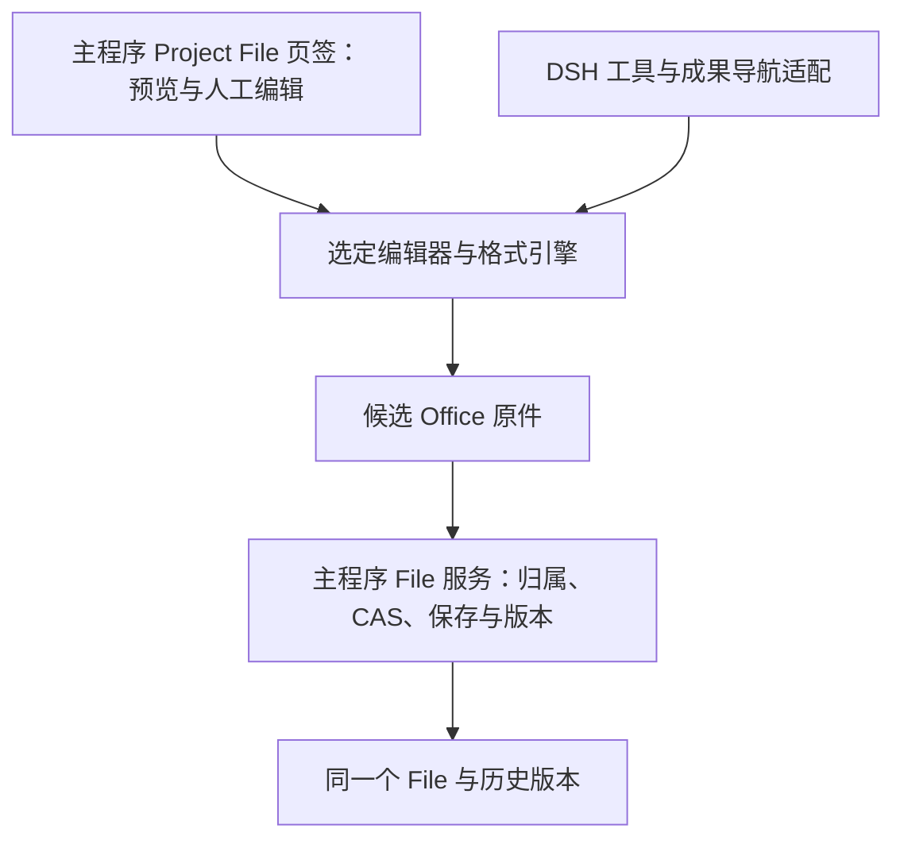
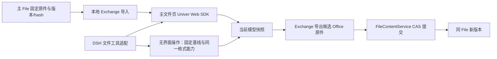

# 主应用文件预览与基础编辑：GenOffice / Univer SDK / DSH 插件调研

核对日期：2026-10-13。关联 [#118](https://github.com/xuchen-cloud/project_mind/issues/118)。状态：源码调查已补充实际 SDK 往返与浏览器验证，结果见 [验证报告](univer-office-validation-20261013.md)；主项目 Office 功能尚未交付。

## 实测后的修订

**当前建议：Office 三类优先提取 GenOffice 的公开核心，分别改装到 Project Mind；DSH 复用主程序的文件能力。** 不搬入完整 Electron 应用，也不要求用户先进入 DSH。固定提交、实测候选和限制见 [验证报告](univer-office-validation-20261013.md)。

| 格式 | 当前路线 | 实测结论与必要补项 |
| --- | --- | --- |
| Word | GenOffice docx-engine + 原 Tiptap 编辑模型 | 同样本段落/表格编辑、图片及复杂未改结构保留较好；薄宿主真键盘保存已过，完整分页/字体 UI 需接入 |
| Excel | GenOffice Gateway/Rust 保存 + Univer OSS 表格 UI | 原样式/元数据与未改部件保留；必须修正 cache-only worksheet 漏写，受测公式修正分支通过 |
| PPT | GenOffice pptx-engine/render + 主程序宿主 | 实际无额外许可水印，备注/模板/图表部件保留较好；当前 UI 探针只覆盖简单文字/PNG，需补产品交互 |
| PDF | 既有 PDF.js 预览 + GenOffice PDFium core 局部原文编辑 | 英文/中文原文替换已实跑，受测未改内容保留；字体供给、GUI 目标定位与最终保存验证需接入 |
| Markdown | 既有 GFM 预览 + 源码编辑，可用 CodeMirror 6 | 31 项源字节/解析/SSR 检查通过；不引入 GenOffice 富文本转换，需补 GUI/CAS 和重复图片引用修正 |

用户确认个人自用、PPT 不能有水印。Univer Slides Pro 未配置许可时的明显水印，加上复杂 PPTX 往返内容损失，使其不满足本需求。Univer Word/Excel 的实际结果作为对照保留：Traditional/Drawing/FORCED 有效，但字体/元数据等保存差异仍存在。下文早期架构和发布包比较是依据，当前实测优先。

用户另加 PDF、Markdown：见 [PDF 专题](pdf-integration-candidate-research-20261013.md)、[Markdown 专题](markdown-integration-candidate-research-20261013.md)。这两类按自己的编辑与原格式保存边界选择，不能把 Office 通过推及其全部能力。

## 用户确认的产品目标

**把 Word、Excel、PPT、PDF、Markdown 的预览与简单内容编辑接入 Project Mind 主程序的 Project File 页签；DSH 适配使用同一套能力。** 普通用户可以直接打开文件、改内容、保存和查看历史，不需要先打开 DSH 聊天。接受针对选中开源项目进行改装；不以能否一条命令接入 DSH 作为选型标准。

Office 优先范围为 `.docx/.xlsx/.pptx`，并扩展调查 PDF 与 Markdown。基础编辑可以小于完整 Office，但保存时不能静默丢失未支持的内容。现有 File 身份、版本、hash/CAS、归属和恢复机制继续作为业务保存权威。

## 当前可行性判断

GenOffice 与 Univer 都存在三类文件的实际内容编辑路径，具备改装为主应用编辑能力的技术基础。主要差别在文件模型：GenOffice 以 OOXML 原件及局部补丁为核心；Univer 将 Office 转换为 SDK 的 UnitData/快照，编辑后重新导出。`.univer` SQLite 容器是 DSH 插件采用的持久化方案，直接 SDK 接入不要求使用它。源码可行性不能代替中文、表格、公式、图片和页序的真实往返验证。

| 比较维度 | GenOffice | 直接 Univer SDK（按格式评估） | 提取 DSH 插件相关模块 |
| --- | --- | --- | --- |
| 三格式基础内容编辑 | 有 Docs/Sheets/Slides | Web SDK 的 Docs/Sheets/Slides | 有 Doc/Sheet/Slide Viewer 与 SDK |
| 主应用前端 | 提取 React 编辑器，改 Electron preload | 在 React 文件页挂载 SDK 容器 | 提取 Viewer，改 Host 传输/授权 |
| Office 文件模型 | 原件解析后做局部补丁 | Office ↔ UnitData/快照 | Office ↔ `.univer` ↔ 导出 Office |
| 本地运行 | DOCX/PPTX Node、XLSX Rust sidecar | Node Exchange 转换及所需 native binding | Node Gateway/Worker、SQLite 与 native binding |
| 主应用保存 | 候选原件 → FileContentService | 当前快照导出候选原件 → 同一服务 | 临时 `.univer` 导出候选原件 → 同一服务 |
| DSH 适配 | 共享格式工具与成果导航 | 主应用领域操作适配到 Facade/Headless | 可借鉴已有 tools/skills，提交接回主 File 服务 |
| 关键接入边界 | 薄宿主/受测保存已验证；完整格式 UI、目标 WebView、缓存修正 | 已有转换/GUI实测差异；目标 WebView和发行未验收 | 同 SDK 边界；插件传输需改为主 File 服务 |

这些是架构推导；具体上游证据和限制见后文。

**统一文件打开与保存契约，按格式保留实际编辑模型。** GenOffice Word/PPT 公开核心和 Excel 原件保存链已有同样本执行证据；公开代码的局部复用不构成全格式无损承诺。主 File 实际回存、目标平台包体和实施工时尚无验收结果。

## 推荐的共同架构

主 UI 和 DSH 共享格式能力、对象定位和保存契约。具体三类格式按需要适配，不建设通用插件平台。人工编辑和 DSH 修改不能各维护一份权威文件；DSH 原有会话审核与编辑器临时状态也不能冒充已经保存的 File Version。

## 直接 Univer SDK：已验证的对照路线

### 最小组合

官方提供非协同接入模式：Web SDK 在浏览器编辑，Node Exchange 将 Office 原件转换为 UnitData，并将修改后的快照导出 Office；不要求 Collaboration Server。我们可结合已有本地 Node 部署，以格式 worker 提供转换。隔离试验已跑通转换与浏览器保存链，主项目 worker 和 File 提交仍是接入工作。[官方非协同接入](https://docs.univer.ai/server/import-export)、[Exchange 边界与格式](https://docs.univer.ai/server/import-export/node)。

| 范围 | 建议起点 | 本期判断 |
| --- | --- | --- |
| Excel 界面 | `@univerjs/preset-sheets-core` + `@univerjs/presets` | 单元格、简单公式与基础格式；复杂功能按需加 |
| Word 界面 | `@univerjs/preset-docs-core` + `@univerjs/presets` | 段落与基础格式；增强表格等额外包单独核实 |
| PPT 界面 | Plugin Mode：共享 core/UI/render/Docs/Drawing + `@univerjs-pro/slides`、`slides-ui`、license | 文字、形状和图片；当前官方说明无 Slides preset |
| Office 转换 | 本地 `@univerjs-pro/exchange-node` 与实际需要的 native binding | 打开和保存原 Office 格式需要 |
| 持久化 | 当前编辑快照 + 主项目 Office File/version 服务 | 快照为会话模型，主文件为保存权威 |
| 协同/独立历史/资源库 | Collaboration Server、SQLite/worktree、素材目录 | 单人基础编辑没有这些需求 |
| DSH | 主应用文件领域操作适配到 Facade/Headless | 共用格式/保存服务；插件 tools 作实现参考 |

来源：[Sheets 安装](https://docs.univer.ai/guides/sheets/getting-started/installation)、[Docs 安装](https://docs.univer.ai/guides/docs/getting-started/installation)、[Slides 安装与依赖](https://docs.univer.ai/guides/slides/getting-started/installation)、[Docs 增强表格](https://docs.univer.ai/guides/docs/features/table)。这不是经过构建验证的最小依赖闭包；先锁定受支持的同版组合，依据真实功能裁剪。

**已对照发布包核实的版本起点：1.0.4。** core、两个 preset、slides、slides-ui、exchange-node 六包均实际发布；Slides UI 与两个 preset 的 React peer 范围包含 19。前五个 Web 包具有 ESM/CJS 入口和类型文件，Exchange 提供 `importBufferToSnapshot` / `exportSnapshotToBuffer` 等直接快照转换 API，类型覆盖 DOCX/XLSX/PPTX，可作为 worker 接缝候选。初次核对覆盖 manifest、声明与文件存在；随后已实际执行原生 import、SDK 往返与隔离宿主构建，结果见验证报告。[core](https://registry.npmjs.org/@univerjs%2fcore/1.0.4)、[Docs preset](https://registry.npmjs.org/@univerjs%2fpreset-docs-core/1.0.4)、[Sheets preset](https://registry.npmjs.org/@univerjs%2fpreset-sheets-core/1.0.4)、[Slides](https://registry.npmjs.org/@univerjs-pro%2fslides/1.0.4)、[Slides UI](https://registry.npmjs.org/@univerjs-pro%2fslides-ui/1.0.4)、[Exchange 发布包](https://registry.npmjs.org/@univerjs-pro/exchange-node/-/exchange-node-1.0.4.tgz)。

Exchange 1.0.4 实际依赖的原生 binding 是 **1.0.2**，不能按统一 Web SDK 版本说明擅自改为 1.0.4。它也依赖 collaboration 包；非协同方案免去的是协同服务/存储部署，不代表依赖树没有该包。三个所查 Pro 包（slides、slides-ui、exchange-node）无 license 字段及独立许可文本，授权仍未核实。部分 registry 与 tarball 的条件 exports 顺序不同，集成应遵循实际发布包，不能由 registry 重建入口规则。[Exchange manifest](https://registry.npmjs.org/@univerjs-pro%2fexchange-node/1.0.4)、[Slides 发布包](https://registry.npmjs.org/@univerjs-pro/slides/-/slides-1.0.4.tgz)、[Slides UI 发布包](https://registry.npmjs.org/@univerjs-pro/slides-ui/-/slides-ui-1.0.4.tgz)。

需要分别核实 OSS 和许可功能：Slides 位于 Pro scope，增强 Docs 表格也使用 Pro 包，不能由 Sheets/Docs core 的 Apache-2.0 推定全部所需能力均免费、无限分发。插件随包许可不作为 Project Mind 的许可来源；取得覆盖自身产品、功能和版本的授权。如要求全部采用可分发的开源组件，则按格式评估 GenOffice 核心。[Slides 范围](https://docs.univer.ai/guides/slides)、[许可说明](https://docs.univer.ai/server/license)。

官方当前格式表包括旧 Office 导入，但导出以 `.docx/.xlsx/.pptx` 为主。旧格式可导入不等于可按相同旧格式回存；首版仍按三种现代格式验收。网页显示 v1.0.4，实际依赖组合需要对照发布包；不能把新版网页当成插件 1.0.2 的能力证明。[官方格式表](https://docs.univer.ai/server/import-export/node)。

### 主程序打开、编辑与保存

主 File 服务核对归属和固定 version/hash，向转换 worker 提供宿主管理的输入副本；Exchange 输出 UnitData，由对应 SDK 在主 React 内容区创建 unit。每个打开的文件有独立会话与基线。人工修改走 commands/Facade，保留 SDK 模型和撤销同步；`save()` 只取得快照，不代表 Office 文件写出或业务版本提交。

显式保存把当前快照交给本地 worker 导出候选文件，再以原基线进入已有 staged/CAS 保存。成功才更新基线；失败保留未保存编辑。历史从固定 Office 原件重建只读会话，恢复使用主服务生成新版本。DSH 独立修改也以明确基线提交；已打开人工会话处理版本变化，避免互相覆盖。[Docs 快照](https://docs.univer.ai/guides/docs/features/core/docs-api)、[Sheets API](https://docs.univer.ai/guides/sheets/features/core/sheets-api)、[Slides 快照与命令约束](https://docs.univer.ai/guides/slides/features/core/slides-api)。

自定义保存按钮可以调用我们的宿主转换接口；不用先搭建 HTTP/WS Gateway 才能完成上述路径。若使用 SDK 内置 import/export 菜单，再实现其要求的应用 API。具体传输优先沿用主项目专用 worker 模式。[官方按钮接入](https://docs.univer.ai/server/import-export)。

React 18/19 已有官方嵌入与清理示例，Safari 有兼容目标；WKWebView/WebView2 的中文输入、字体、剪贴板、快捷键和页签释放仍须实测。按格式延迟加载，关闭页签释放实例/监听器；首版各文件独立实例。官方 Slides UI 自动加载 Pro 公式引擎，同实例若也加载 Sheets 的另一公式引擎，需要遵循初始化约束。[React 接入](https://docs.univer.ai/guides/docs/getting-started/integrations/react)、[浏览器目标](https://docs.univer.ai/guides/docs)、[Slides 初始化](https://docs.univer.ai/guides/slides/getting-started/installation)。

### DSH 与试验顺序

DSH 暴露限定的文件操作，例如改指定工作表单元格、文档段落、指定页文字。内部适配已注册的 Facade/Headless 能力，主服务用 File ID/版本/hash 解析目标，提交结果导航回同一 File。插件可参考其 API 调用、转换选项和错误映射；本期不需要复刻其 worktree 合并与素材库。

先核实必要包和授权，并对三格式各跑无修改、一次小修改往返，尽早发现格式门槛；再以 XLSX 单元格编辑完成主 File 页签与保存闭环，随后补 DOCX、PPTX。空白编辑器或仅 Excel 成功不能代替三格式 Office 交付。最后集中验收主窗口操作、历史/恢复及人工/DSH/外部变更冲突。若某一格式不达标，按该格式评估 GenOffice。

## GenOffice：三类编辑与保存的源码证据

上游固定提交为 [`d32d1711f1bf985430757b8c6b3fbddd3831d946`](https://github.com/genspark-ai/genoffice/commit/d32d1711f1bf985430757b8c6b3fbddd3831d946)。不能只抽编辑器画布：原格式模型、编辑操作、保存计划、字体和编辑会话也是闭环的一部分。

| 格式 | 可抽取模块与基础能力 | 原格式保存机制 | 具体限制 |
| --- | --- | --- | --- |
| DOCX | `docx-engine` + Docs renderer 的转换、Tiptap 扩展及分页；段落、列表、表格、图片的编辑路径 | `parseDocx` → Block/Tiptap → `pmDocToSavePlan` → `saveDocx`；original 块复用原 XML，generated 块重新生成；满足无修改条件可返回原字节 | GUI 按模型签名选择复用或重建，不保证只重建用户触碰的段落；没有原锚点的保护节点在特定复制/生成路径可能跳过 |
| PPTX | `pptx-engine`、`pptx-render`、`pptx-ops` + Slides renderer；文字、表格单元格、位置/尺寸、图片替换、增删页 | `SlideDeck/PackageArchive` → RenderTree → React/Konva；保存对 dirty slide 装配元素 XML，复用未改元素/部件 | 图表转为可编辑后重建可丢细格式；新增字符超出嵌入字体子集时可能移除字体并改变排版；SmartArt/OLE 的预览不等于完整编辑 |
| XLSX | Sheets renderer + `xlsx-gateway` + Rust `xlsx-sidecar`；多工作表、值、公式及常见样式 | 编辑日志 → OOXML mutation plan → sidecar ZIP 装配；未改部件 raw copy，manifest 门禁拒绝非计划变化 | 公式由 IronCalc 计算，不能保证全部 Excel 语义；修改条件格式可能重新序列化该表全部规则并丢未映射细节；部分结构组合拒绝保存 |

DOCX 证据：[引擎入口](https://github.com/genspark-ai/genoffice/blob/d32d1711f1bf985430757b8c6b3fbddd3831d946/packages/docx-engine/src/index.ts)、[GUI 保存](https://github.com/genspark-ai/genoffice/blob/d32d1711f1bf985430757b8c6b3fbddd3831d946/apps/docs/src/renderer/file-actions.ts#L692-L808)、[保存分支](https://github.com/genspark-ai/genoffice/blob/d32d1711f1bf985430757b8c6b3fbddd3831d946/packages/docx-engine/src/patch.ts#L639-L705)、[签名与保护节点](https://github.com/genspark-ai/genoffice/blob/d32d1711f1bf985430757b8c6b3fbddd3831d946/apps/docs/src/renderer/editor/convert.ts#L2429-L2471)。

PPTX 证据：[操作与保存](https://github.com/genspark-ai/genoffice/blob/d32d1711f1bf985430757b8c6b3fbddd3831d946/packages/pptx-engine/src/index.ts#L685-L822)、[主进程会话](https://github.com/genspark-ai/genoffice/blob/d32d1711f1bf985430757b8c6b3fbddd3831d946/apps/slides/src/main/slides-main.ts)、[图表重建说明](https://github.com/genspark-ai/genoffice/blob/d32d1711f1bf985430757b8c6b3fbddd3831d946/packages/pptx-engine/src/index.ts#L2999-L3026)、[嵌入字体处理](https://github.com/genspark-ai/genoffice/blob/d32d1711f1bf985430757b8c6b3fbddd3831d946/packages/pptx-engine/src/embedded-fonts.ts#L255-L330)、[预览模型](https://github.com/genspark-ai/genoffice/blob/d32d1711f1bf985430757b8c6b3fbddd3831d946/packages/pptx-render/src/build-slide.ts)。

XLSX 证据：[编辑日志](https://github.com/genspark-ai/genoffice/blob/d32d1711f1bf985430757b8c6b3fbddd3831d946/apps/sheets/src/renderer/save-actions.ts)、[部件保存与校验](https://github.com/genspark-ai/genoffice/blob/d32d1711f1bf985430757b8c6b3fbddd3831d946/packages/xlsx-gateway/src/gateway/xlsx-package-io.ts)、[Rust archive](https://github.com/genspark-ai/genoffice/blob/d32d1711f1bf985430757b8c6b3fbddd3831d946/apps/sheets/native/xlsx-engine/src/archive.rs)、[公式与缓存处理](https://github.com/genspark-ai/genoffice/blob/d32d1711f1bf985430757b8c6b3fbddd3831d946/apps/sheets/native/xlsx-engine/src/recalc.rs)、[条件格式边界](https://github.com/genspark-ai/genoffice/blob/d32d1711f1bf985430757b8c6b3fbddd3831d946/apps/sheets/docs/compatibility.md#L60-L70)。

### 保存、宿主与证据的边界

- DOCX 编辑后一般重新装配 ZIP；PPTX 无编辑也会装配 ZIP。原 XML/未改部件保留不等于整个 Office 文件字节不变，也不证明已改部件内部全部保真。XLSX 流式 manifest 校验以 CRC32/尺寸为主；真实验收需额外比较内容和语义。
- DOCX 懒媒体路径、PPTX 字体/流式输出、XLSX gateway 都含 Node 能力。`xlsx-sidecar` 是独立 Rust CLI，由 Node spawn 后以 JSONL 通信；不是直接可放进浏览器的 WASM SDK。[DOCX Node 路径](https://github.com/genspark-ai/genoffice/blob/d32d1711f1bf985430757b8c6b3fbddd3831d946/packages/docx-engine/src/zip-splice.ts)、[XLSX gateway](https://github.com/genspark-ai/genoffice/blob/d32d1711f1bf985430757b8c6b3fbddd3831d946/packages/xlsx-gateway/src/gateway/xlsx-gateway.ts)、[sidecar client](https://github.com/genspark-ai/genoffice/blob/d32d1711f1bf985430757b8c6b3fbddd3831d946/apps/sheets/src/main/xlsx-sidecar-client.ts)。
- 上游 PPTX `slides:save` 直接把真实 session path 交给流式写出。我们必须改成候选临时输出，再经 File 服务提交，避免写出失败或基线冲突时已覆盖原件。[上游保存入口](https://github.com/genspark-ai/genoffice/blob/d32d1711f1bf985430757b8c6b3fbddd3831d946/apps/slides/src/main/slides-main.ts#L4450-L4498)。
- 上游有 DOCX roundtrip、PPTX patch/rebuild、XLSX preservation/streaming 测试；本轮只读测试，未执行。引擎手工保存计划的断言不能代替 GUI 保存链与外部 Office 验收。[DOCX 测试](https://github.com/genspark-ai/genoffice/blob/d32d1711f1bf985430757b8c6b3fbddd3831d946/packages/docx-engine/tests/roundtrip.test.ts)、[PPTX 测试](https://github.com/genspark-ai/genoffice/blob/d32d1711f1bf985430757b8c6b3fbddd3831d946/packages/pptx-engine/tests/patch.test.ts)、[XLSX 测试](https://github.com/genspark-ai/genoffice/blob/d32d1711f1bf985430757b8c6b3fbddd3831d946/apps/sheets/tests/xlsx-streaming-save.test.ts)。

公开 Issue 也需按版本解释：[#524](https://github.com/genspark-ai/genoffice/issues/524) 是旧版本复杂修订 DOCX 的未触碰段落重建报告，本轮未复现；当前仍存在签名决定重建的机制。旧版本 [#1002](https://github.com/genspark-ai/genoffice/issues/1002) 报告 metadata 无实际解压上限，但当前 `read_zip_string` 已使用有界读取，单部件 cap 为 500 MiB。不能把 Issue 尚 open 当成当前仍无上限；峰值内存和累计预算仍需测量。[当前实际计量](https://github.com/genspark-ai/genoffice/blob/d32d1711f1bf985430757b8c6b3fbddd3831d946/apps/sheets/native/xlsx-engine/src/xml_util.rs#L76-L114)。

### GenOffice 许可与资源

公开核心为 Apache-2.0；`ee/` 是独立 Enterprise License，生产/分发需另有协议，本需求可先只选公开核心。主要前端依赖 React/Tiptap/Konva 为 MIT，表格 UI 使用 Univer OSS 0.25.1（Apache-2.0）；JSZip 可选 MIT 分支。不是完整依赖法律审计，裁剪后仍须核实实际分发清单及 Rust crates。[核心 LICENSE](https://github.com/genspark-ai/genoffice/blob/d32d1711f1bf985430757b8c6b3fbddd3831d946/LICENSE)、[EE 许可](https://github.com/genspark-ai/genoffice/blob/d32d1711f1bf985430757b8c6b3fbddd3831d946/ee/LICENSE)、[固定锁文件](https://github.com/genspark-ai/genoffice/blob/d32d1711f1bf985430757b8c6b3fbddd3831d946/package-lock.json)。

需保留 LICENSE/NOTICE、第三方和字体通知及修改说明；部分字体为 OFL-1.1，有 Reserved Font Name 约束，Caladea 为 Apache-2.0。中文子集不覆盖所有罕见字，系统字体回退与分页需实测。[NOTICE](https://github.com/genspark-ai/genoffice/blob/d32d1711f1bf985430757b8c6b3fbddd3831d946/NOTICE)、[字体说明](https://github.com/genspark-ai/genoffice/blob/d32d1711f1bf985430757b8c6b3fbddd3831d946/apps/docs/src/renderer/fonts/README.md)。

## Project Mind 接入评估

### 本次工作包与证据范围

- 关联 Issue：[项目文件预览与编辑 #118](https://github.com/xuchen-cloud/project_mind/issues/118)，对应 F03 Office 候选调查。F03 还要求真文件试验，本报告不能记为 F03 已完成。
- 依赖：现有 Project File 页面、固定 File Version 字节读取、FileContentService 与原生版本提交；上游三类格式引擎及其前端。
- 交付：判断基础预览/编辑是否存在、说明 Tauri 接入路径与保存契约、给出最小试验和验收标准。
- 非目标：本轮不交付 Office 编辑、不改变 AI 工具白名单、不建立第二套文件正文/版本存储，不承诺旧二进制格式或完整 Office 兼容。
- 验证：一手源码、依赖清单、上游测试源码与公开 Issue 的静态核对；主项目基线 `f177d59cfa305758a44c21d302aee4e88956ccc9` 加当前工作树。未安装/运行 GenOffice、未执行真实 Office 文件往返、未验证 WKWebView/WebView2、未测性能和最终包体。用户已有其他工作树改动不在本报告修改范围。上游源码以固定提交的 GitHub API 获取并核实。

### 我们已经有的接缝，和还需补的部分

| 范围 | 已核实的主项目实现 | 接入时的工作 |
| --- | --- | --- |
| 文件页面 | `src/components/document/ProjectFileContent.tsx` 承接当前/固定历史版本；`projectFilePreviewKind` 将 doc/docx/xls/xlsx/ppt/pptx 归为 unsupported | 按格式延迟加载编辑器；复用 File 身份和版本选择；查看历史保持只读 |
| 原始输入 | `src/services/projectFileApi.ts` 的 `readBytes` 读取指定版本/hash；`src-tauri/src/db/project_directory_files.rs` 核实实际归属、保留原件和 SHA-256 | 把固定原件送入格式会话；不能从检索抽取文本重建 Office 原件 |
| 二进制回存 | `src-tauri/src/file_content.rs` 已有 begin/append/finish/update，完整长度/hash 校验、版本/hash CAS、幂等及原生提交；100 MiB 内容和 1 MiB 分块上限 | 当前 `fileDocumentApi` 只有版本、原文与恢复入口，需补可信 GUI 薄适配，把格式引擎产出的候选字节送到已有服务 |
| 运行时 | `scripts/prepare-desktop-runtime.mjs` 打包固定 Node；`src-tauri/src/record_document_worker.rs` 已有独立文档 utility 进程模式 | 可以复用 Node 二进制和部署机制，为 DOCX/PPTX 提供专用格式 worker；这是架构建议，现有 worker 方法白名单尚不含 Office |
| 表格引擎 | 主项目有 Rust 宿主，但未接入 GenOffice XLSX engine | 优先保持上游 Rust sidecar 协议，按平台构建和分发；是否改为链接库留到真实试验，不能仅凭两边都用 Rust 宣称直接兼容 |

以上本地证据分别见：[文件页面](../../src/components/document/ProjectFileContent.tsx)、[字节 API](../../src/services/projectFileApi.ts)、[原件核对](../../src-tauri/src/db/project_directory_files.rs)、[二进制保存](../../src-tauri/src/file_content.rs)、[GUI 版本 API](../../src/services/fileDocumentApi.ts)、[运行时打包](../../scripts/prepare-desktop-runtime.mjs)、[文档 utility](../../src-tauri/src/record_document_worker.rs)。

### GenOffice 候选的集成结构（推导，尚未实现）

在现有 Project File 内容页嵌入经过裁剪的 Docs/Sheets/Slides 前端，保留支持需求的工具栏、渲染、编辑与撤销。把 Electron preload 的文件能力改为明确的宿主接口。按固定上游提交提取所需 workspace 源码并保留可追溯的改动，后续按需同步；这些 workspace 的 package.json 标为 private，本轮没有证实存在可直接安装的嵌入 SDK。主项目与上游都用 React 19；Docs 的 Tiptap 与 Slides 的 Konva 在主项目中已有相同技术栈，但版本并不完全相同，仍需锁定并验证，不能直接混装。现有 Record 的 Tiptap 编辑器和 DOCX 导出并不具备外部 DOCX 导入及原件回存能力，不能拿它们替代 GenOffice 的格式模型和保存引擎。

格式引擎只操作宿主管理的原件副本/编辑会话，输出候选字节或候选临时文件；Project Mind 独占真实 File 的生效提交。不能沿用上游编辑器直接覆盖原路径后再登记版本的流程：基线在编辑过程中可能已被外部软件或 Agent 修改，这会绕过现有 CAS 的保护意图。

一次完整路径应为：读取固定 version/hash → 建立编辑会话 → 修改内容 → 引擎生成候选原件 → GUI 以原基线调用现有 staged save → 原生服务再次核对实际文件及版本 → 成功后以新版本重新建立基线。冲突时保留未保存编辑并提示重新核对；不能把格式引擎写出成功当作业务保存成功。切 Workspace、关闭页签、恢复历史和外部变更均需协调会话生命周期。上游自己的最近文件、Project Store、恢复目录、AI 历史不应成为第二份权威存储；需要的临时恢复内容必须绑定我们同一 File 和基线。

产品主体是主应用 Project File 页签，文件预览、人工编辑、保存与历史不依赖 DSH 会话。DSH 后续通过同一格式能力和 File 服务读取/修改/提交并打开成果链接，不再单独维护一套 Office 编辑界面。这条路线不要求用户配置模型；普通文件查看和人工编辑应独立于 Agent 运行。可复用上游非 AI 模块，但裁剪 AI 面板还需解除初始化依赖，不能只隐藏按钮。

### 为什么不能直接 iframe 整个 GenOffice

已核实上游 shell 使用 Electron `BrowserWindow`/`WebContentsView` 管理子编辑器，三类 preload 使用 `contextBridge` 和 `ipcRenderer` 暴露 `desktop`/`desktopApi`/`slidesApi`，打开/保存/字体等操作由 Electron 主进程处理。将 renderer HTML 放进 iframe 并不会提供这些能力；上游 shell 本身也不是 HTTP Office 编辑服务。

证据：[shell tab manager](https://github.com/genspark-ai/genoffice/blob/d32d1711f1bf985430757b8c6b3fbddd3831d946/apps/shell/src/main/tab-manager.ts)、[Docs preload](https://github.com/genspark-ai/genoffice/blob/d32d1711f1bf985430757b8c6b3fbddd3831d946/apps/docs/src/preload/index.ts)、[Sheets preload](https://github.com/genspark-ai/genoffice/blob/d32d1711f1bf985430757b8c6b3fbddd3831d946/apps/sheets/src/preload/index.ts)、[Slides preload](https://github.com/genspark-ai/genoffice/blob/d32d1711f1bf985430757b8c6b3fbddd3831d946/apps/slides/src/preload/index.ts)。Tauri 前端使用系统 WebView，不运行 Electron preload；macOS WKWebView 与 Windows WebView2 都需要真实界面验收。[Tauri 进程模型](https://v2.tauri.app/concept/process-model/)、[外部二进制分发](https://v2.tauri.app/develop/sidecar/)。

上游协作者在 [#163 的回复](https://github.com/genspark-ai/genoffice/issues/163#issuecomment-5468979747) 中表示浏览器版正在开发和内部测试，没有承诺发布日期；[#5](https://github.com/genspark-ai/genoffice/issues/5) 也有同类回复。本轮未找到可供直接接入的公开浏览器版 SDK 或服务。这是截至核对时的公开证据，不推断其内部进度，也不以未发布版本作为我们的实施依赖。

| 方式 | 能否满足应用内简单编辑 | 判断 |
| --- | --- | --- |
| 裁剪前端 + 复用格式引擎 + Tauri 宿主适配 | 技术路径可行，需验证 | 推荐候选；可保持本地与现有 File 提交规则 |
| 直接 iframe 上游 renderer | 不能开箱即用 | 缺 Electron IPC 和文件会话；仍需完成宿主适配 |
| 启动 GenOffice 外部窗口 / 只调用 CLI | 不满足本需求的应用内界面 | CLI 可用于以后格式工具试验，不能替代人工编辑界面 |
| 等待上游浏览器版 | 公开交付接口尚未核实 | 可关注，不能作为当前可执行方案 |

### 最小产品范围与后续验证包

若采用 GenOffice，建议先做 DOCX 的一条完整闭环，利用我们已有 React/Tiptap 和 Node 部署经验验证拆取方式；通过后分别推进 XLSX 与 PPTX。三格式独立判断，DOCX 成功不能替代另两类的验收。优先支持 `.docx/.xlsx/.pptx`；旧 `.doc/.xls/.ppt` 覆盖和转换需要另测。

| 格式 | 第一版基础行为 | 真实样例验收 |
| --- | --- | --- |
| DOCX | 分页查看中文段落、表格、图片；改段落文字和表格单元格；基础格式 | 修改一段和一个表格单元格，保存重开；核对未修改图片、页眉页脚、样式；用 Word 或目标原格式工具复开 |
| XLSX | 查看多工作表、单元格和基础样式；改文本/数值及简单公式 | 修改值与 `SUM` 等已验证公式，保存重开；核对公式本体、计算值、工作表与合并单元格；保留未编辑图表/其他 parts |
| PPTX | 查看页面与页序；改文本框文字、移动元素、替换图片 | 修改两页中的文字和图片，保存重开；核对页序、母版/版式和未触碰对象；用 PowerPoint 或目标原格式工具复开 |

共享必须验证：同 File 新版本、固定历史只读、恢复生成新版、人工/Agent/外部写入冲突、不覆盖原件的失败路径、关闭重开一致。只读预览成功不等于编辑回存通过；生成有效 ZIP 也不等于 Word/Excel/PowerPoint 实际接受。

首个试验先执行无窗口引擎往返、OOXML 结构与未改 parts 比较，再集中执行 WKWebView/WebView2 编辑、中文输入法、剪贴板、字体与缩放验收。复杂内容应明确区分“可查看”“原样保留”“可编辑”；无法保证保留的文件限制编辑并保留原件，不进行静默格式降级。

性能和分发在原型后测量：冷启动/首次打开、中文长文档、含图片演示文稿、较大工作簿、后台页签内存、增量包体，以及目标平台 sidecar 构建、签名和资源路径。没有实测数据时不写具体耗时或包体数字，也不承诺实施天数。

### GenOffice 作为备选的判断

GenOffice 值得进入 #118 的候选试验：已存在满足基础需求的真实格式编辑路径，主项目也具备可复用的 File 服务与本地运行时。接入属于组件提取和宿主迁移工程，工作量主要在 Electron 解耦、编辑会话、原生保存适配及目标引擎的往返验证，而非自己实现完整 Office 套件。

当前结论是“源码层面可行、建议做最小集成试验”，不是“已证明三格式可在 Project Mind 安全稳定编辑”。最终选型需以真实文件和两类目标 WebView 验收决定。

## DSH Univer Office：新增候选的主项目接入评估

### 版本与身份

用户提供的 `dsh plugin --profile web add dsh-univer-office` 对应 [dream-num/dsh-univer-office](https://github.com/dream-num/dsh-univer-office)，Univer 官方生态页也收录它。2026-10-13 核对 npm 正式 registry 的最新发布为 `0.3.7`，`gitHead` 与 GitHub main 同为 `8f85ce4074fdbe51416b6c337468bb916a302c2a`；下文引用均固定该版本。Node 要求 `>=22.19.0`，匹配主项目已有运行时基线。发布包声明的 DSH peer 范围为 `^0.1.5-rc.3 || ^0.1.7-rc.1 || ^0.2.0-rc.1`，Cordis 为 `^4.0.2`；用本机 semver 核对，主项目 `0.2.0-rc.2` 和 Cordis `4.0.4` 均满足声明范围。这个检查只验证版本范围，不代表组件和协议已接通。未执行用户给出的安装命令，未改变本机 DSH profile。

来源：[官方生态](https://univer.ai/ecosystem)、[npm 0.3.7 发布元数据](https://registry.npmjs.org/dsh-univer-office/0.3.7)、[固定版本 package.json](https://github.com/dream-num/dsh-univer-office/blob/8f85ce4074fdbe51416b6c337468bb916a302c2a/package.json)。发布元数据包括构建时注入的 native binding 依赖，可能与源码 package.json 不同，不能只看源码 dependencies 判断发行包。

### 它真的覆盖三类 Office，也能人工编辑

插件支持 Sheet、Doc、Slide，以及 Base 和 Board。官方能力表明确列出 `.xlsx/.docx/.pptx` 导入、相应内容编辑和按对应格式导出。它不止是 Excel 插件，也不止是静态截图。Viewer 的 `createViewer` 有 `editable` 参数，使用协作客户端发送 changeset；草稿/审阅与当前主线的编辑权限不同，预览入口不一律可写。文件树可以按需打开 `.univer`，不需要模型先执行操作。

但源 Office 文件需要先转换为 `.univer` 容器：一个容器可以包含多个 Unit，并在内部保存协作、历史和 worktree。这不同于 GenOffice 围绕 OOXML 原件补丁的路线。确认 `.univer` worktree 合入当前版本，不等于同一个 Project File 的 `.docx/.xlsx/.pptx` 已保存；还需要导出并通过主项目原生保存服务提交。

来源：[中文 README](https://github.com/dream-num/dsh-univer-office/blob/8f85ce4074fdbe51416b6c337468bb916a302c2a/README.zh-CN.md)、[Viewer 的可编辑契约](https://github.com/dream-num/dsh-univer-office/blob/8f85ce4074fdbe51416b6c337468bb916a302c2a/src/viewer-app/core/viewer.ts)、[架构与 `.univer` 持久化](https://github.com/dream-num/dsh-univer-office/blob/8f85ce4074fdbe51416b6c337468bb916a302c2a/docs/architecture.md)。

### 主应用改装路线：提取 Viewer / Gateway / Worker，DSH 共享调用

插件的 Gateway、Viewer、一次性 Unit Content Worker 均随包提供；没有全局 Univer CLI 依赖，也不要求另起云端 Office 服务。Host 用本地 Node 启动 Gateway；Viewer 是浏览器应用，通过 HTTP/WebSocket 通信，插件已经采用 iframe 展示。这使它省去 GenOffice 的 Electron shell/preload 迁移，是有实际价值的接入优势。

选型前提是需要改装并以主应用 File 页签为产品入口。具体应复用 Viewer 编辑/渲染、Gateway 会话与 Unit Content Worker 导入导出，把它们从 DSH 的会话卡片、文件树和审核流程中解耦。普通打开文件、人工编辑、保存和历史都不要求进入 DSH 聊天或配置模型；DSH 通过薄工具适配调用同一套主应用文件服务。下面列的是已找到的改装位置，不把缺少开箱即用接入作为否定该候选的理由：

| 差距 | 已核实事实 | 必要适配 |
| --- | --- | --- |
| DSH 适配 | 主应用 DSH runtime 使用自管 profile，客户端显式装配固定模块 | 在共享 Office 能力之上适配 tools/skills 和成果导航；默认 web 安装命令只作为上游试用入口，不是主应用实施方式 |
| 主 UI 与 DSH UI | 上游 Client 将功能投影为聊天卡片/浮窗；主应用文件页独立于会话 | 主 UI 提取 Viewer 进入 File 页签；按需要给 DSH 注册导航与结果展示，避免再建一套编辑器 |
| Project 文件区 | 主项目隐藏 DSH 文件树、右侧预览；上游原生预览认领的是 `.univer` 地址 | 接到主 Project File 页签，不能靠恢复一套 DSH 文件树交付 |
| HTTP origin | 插件 client 用 `window.location.origin + '/univer-api/...'`；Viewer iframe 使用 `/univer-viewer/...`，资源/协作使用 `/uf/...` | 主应用 origin 与 Node DSH origin 分离，要有受约束的资源、API、认证与 WS 传输桥 |
| Tauri 当前传输 | `src-tauri/src/dsh_assistant.rs` 的 `carrier_path` 仅接受 `/api/`，且是 JSON RPC、上传和文件读取的明确接口；插件上面的路径不在契约内 | 增加与当前 Project/File/编辑会话绑定的专用接缝，不能直接放开任意路径 |
| 桌面协议 | 上游 Viewer 专门处理 `dsh-app:`；我们的主前端使用 Tauri/Vite origin | 复用协议设计，补我们的初始化与 WebSocket 连接方式；不能宣称已有桌面分支直接支持 Tauri |
| 保存与历史 | 上游 Gateway 直接持续写 `.univer` 的 SQLite/changeset；Mind 对 Office File 使用不可变版本、hash/CAS | 编辑临时副本，导出候选原件，复用现有 FileContentService 提交；上游内部历史不冒充 File Version |

主项目证据：[DSH 运行时](../../packages/dsh-assistant/scripts/runtime.mjs)、[固定客户端](../../packages/dsh-ui/adapters/client.jsx)、[通信适配](../../packages/dsh-ui/adapters/transport.mjs)、[原生 carrier](../../src-tauri/src/dsh_assistant.rs)、[嵌入职责](../../packages/dsh-ui/README.md)。上游证据：[client HTTP](https://github.com/dream-num/dsh-univer-office/blob/8f85ce4074fdbe51416b6c337468bb916a302c2a/src/client/api/univer-api.ts)、[iframe 入口](https://github.com/dream-num/dsh-univer-office/blob/8f85ce4074fdbe51416b6c337468bb916a302c2a/src/client/components/univer-preview-body.tsx)、[桌面 transport](https://github.com/dream-num/dsh-univer-office/blob/8f85ce4074fdbe51416b6c337468bb916a302c2a/src/viewer-app/core/desktop-transport.ts)、[Gateway launcher](https://github.com/dream-num/dsh-univer-office/blob/8f85ce4074fdbe51416b6c337468bb916a302c2a/src/host/processes/gateway/launcher.ts)。

### 不能继承的文件授权边界

上游的同源部署规格明确：Viewer 文档首次打开和 `/univer-api` 请求检查指定 session 的 workspace；后续 `/uf` HTTP 和 WS 只检查 DSH 浏览器身份，可寻址 Host 进程有权打开的任意 `.univer` 文件。`viewer-proxy.ts` 的 HTTP/upgrade 路径也与这个契约一致。这是上游公开设计，不是本轮已复现漏洞。

Project Mind 要求绑定当前 Project/File/Workspace generation，不能把“浏览器已通过 DSH 鉴权”当作跨 Project 文件修改授权。因此接入时需要把后续协作读写也绑定到允许的编辑副本与当前会话，项目切换时关闭旧流。只校验第一次 iframe URL 不足以满足我们的业务边界。

来源：[上游明确的授权契约](https://github.com/dream-num/dsh-univer-office/blob/8f85ce4074fdbe51416b6c337468bb916a302c2a/docs/viewer-same-origin-deployment.md)、[代理实现](https://github.com/dream-num/dsh-univer-office/blob/8f85ce4074fdbe51416b6c337468bb916a302c2a/src/host/webServer/viewer-proxy.ts)、[主项目范围约定](../../CONTEXT.md)。

### Office 转换的实际边界

DOCX 默认使用 `traditional` 模式保留页面设置；`modern` 改为无页布局，不能用于承诺原页面几何。XLSX 导入会强制公式计算；Agent 导出也强制计算，Viewer Gateway 导出则在缓存缺失时计算。因此，未编辑也可能改变公式缓存结果，需要核对目标业务公式。PPTX 的母版、版式页和演讲者备注目前不在插件编辑范围；这既不证明必然丢失，也不证明原样回存。

转换实现会传递 workbook/worksheet/doc/slide 的 `originalMeta`；不能概括为未支持内容全部丢弃。但导出是从当前 UnitData/快照生成 Office 文件，本轮没有找到保留整个原始 OOXML 包或未编辑时直接返回原件的完整保证。插件有窄范围 DOCX 页面几何往返测试，不覆盖复杂模板或全部三格式，本轮也未执行。

来源：[Worker 实际转换及计算](https://github.com/dream-num/dsh-univer-office/blob/8f85ce4074fdbe51416b6c337468bb916a302c2a/src/workers/unit-content/entry.ts)、[Gateway Exchange](https://github.com/dream-num/dsh-univer-office/blob/8f85ce4074fdbe51416b6c337468bb916a302c2a/src/gateway-app/exchange/gateway-exchange-service.ts)、[固定版 Exchange 包与元数据机制](https://registry.npmjs.org/@univerjs-pro/exchange-node/-/exchange-node-1.0.2.tgz)、[页面几何测试](https://github.com/dream-num/dsh-univer-office/blob/8f85ce4074fdbe51416b6c337468bb916a302c2a/test/integration-smoke.mjs#L1098-L1167)、[编辑边界](https://github.com/dream-num/dsh-univer-office/blob/8f85ce4074fdbe51416b6c337468bb916a302c2a/README.zh-CN.md)。

### 插件许可不能覆盖全部运行时

| 层 | 本轮核实 | 选型影响 |
| --- | --- | --- |
| 插件 `0.3.7` | Apache-2.0 | 可以在满足通知等条件时修改、分发插件代码 |
| `@univerjs/core@1.0.2` | npm 声明 Apache-2.0 | 不能据此推定其他 SDK 包同许可 |
| Exchange / 公式原生 binding `1.0.1` | 所读 manifest 无 license，发布包无 LICENSE | 嵌入、商用与二进制再分发范围未核实；不能直接断言免费或付费 |
| Exchange / License / Headless SDK `1.0.2` | 所读发布包缺少完整许可声明；headless README 明确部分 Pro 写操作需有效许可 | 公开可下载不等于已授权全部用途；包名带 Pro 也不等于全部收费 |
| `cli-assets@0.1.0` | 资源目录无 license/版权字段，图片/SVG 使用外部引用 | 如使用这些素材，需另核实对应许可；基础编辑可先不选资源库 |

来源：[插件 LICENSE](https://github.com/dream-num/dsh-univer-office/blob/8f85ce4074fdbe51416b6c337468bb916a302c2a/LICENSE)、[core 元数据](https://registry.npmjs.org/@univerjs%2fcore/1.0.2)、[Exchange binding 发布包](https://registry.npmjs.org/@univerjs-pro/exchange-node-binding/-/exchange-node-binding-1.0.1.tgz)、[Formula binding 发布包](https://registry.npmjs.org/@univerjs-pro/engine-formula-rust-binding/-/engine-formula-rust-binding-1.0.1.tgz)、[Headless 发布包](https://registry.npmjs.org/@univer-cli/headless-univer/-/headless-univer-1.0.2.tgz)、[License 发布包](https://registry.npmjs.org/@univerjs-pro/license/-/license-1.0.2.tgz)、[资源目录发布包](https://registry.npmjs.org/@univerjs-pro/cli-assets/-/cli-assets-0.1.0.tgz)。

Viewer 与 Worker 确实配置随包运行时许可。静态公开载荷类型对应 SDK 的 COMMERCIAL 枚举，域名范围为 `localhost`、`app`，功能到期与升级截止为北京时间 **2027-01-10 00:00**；没有验证签名或执行授权检查。不能根据变量名认定它仅用于测试，也不能因为我们的主机名匹配就认为取得了跨产品分发权。源码注释要求到期前轮换；Viewer 使用随包配置，Worker 的外部许可变量也未通过父进程环境白名单，改装时需建立主应用自己的注入与轮换路径。本报告不摘录许可凭证。

来源：[客户端许可范围注释](https://github.com/dream-num/dsh-univer-office/blob/8f85ce4074fdbe51416b6c337468bb916a302c2a/src/viewer-support/render-preset/license.ts#L1-L2)、[Worker 许可注释](https://github.com/dream-num/dsh-univer-office/blob/8f85ce4074fdbe51416b6c337468bb916a302c2a/src/workers/unit-content/license.ts#L1-L4)、[Viewer 注入](https://github.com/dream-num/dsh-univer-office/blob/8f85ce4074fdbe51416b6c337468bb916a302c2a/src/viewer-app/core/viewer.ts#L176)、[Worker 环境白名单](https://github.com/dream-num/dsh-univer-office/blob/8f85ce4074fdbe51416b6c337468bb916a302c2a/src/host/adapters/unit-content/worker.ts#L88-L106)。

官方文档允许 Node 自托管转换，非协同编辑也能使用，不需要因此引入厂商 SaaS 或完整协同服务。文档同时要求为需要许可的功能取得覆盖版本、功能和有效期的许可。当前网页为 v1.0.4，而插件主要 SDK 为 1.0.2；网页不能代替固定版的分发授权条款。[官方转换接入](https://docs.univer.ai/server/import-export)、[官方许可说明](https://docs.univer.ai/server/license)。

若以后公开发行该路线，需要核对覆盖 Project Mind 桌面发行、所用 SDK/原生二进制及素材的分发说明与许可配置。具体费用、OEM/白标、跨产品使用、是否需联网验证尚未核实；未找到证据的事项不作禁止或免费结论。这些分发信息留作公开发行时的后续核对；用户已确认本轮个人自用，不作为当前验证的阻断条件。运行时水印等限制仍按实测记录。

### 部署和资源范围

当前插件 npm 发布的 `dist.unpackedSize` 为 226,850,899 bytes（约 216 MiB），仅指包本身，不包含全部传递依赖，也不是最终安装包增量。它随包提供本地服务和前端，但还要安装目标平台的 libsql、Office exchange 和公式引擎 native binding；桌面分发需要验证 macOS/Windows 对应产物与打包布局。主项目发布时可复用固定 Node，但这不能代替插件资源准备。

直接 SDK 路线有不同依赖与资源组合，不能把这个插件包大小当成 SDK 方案的包体估计。

截图、PDF 打印、Slide 布局检查、SVG 文字度量需要 Chromium 系浏览器；普通 Viewer 编辑不能因为这些工具需要浏览器就一概认为必须额外安装 Chrome。若第一版只做人工基础编辑，可把这些工具留到明确需要时再验证。用户机器上的浏览器探测不等于我们安装包已具备打印/截图能力。

来源：[npm 正式发布元数据](https://registry.npmjs.org/dsh-univer-office/0.3.7)、[要求与限制](https://github.com/dream-num/dsh-univer-office/blob/8f85ce4074fdbe51416b6c337468bb916a302c2a/README.zh-CN.md)、[native binding 打包规则](https://github.com/dream-num/dsh-univer-office/blob/8f85ce4074fdbe51416b6c337468bb916a302c2a/docs/architecture.md)。

### 可执行的最小试验（未实施）

在隔离的测试目录中按固定版本提取编辑相关模块，先验证主 File 页签里的 Viewer/原生绑定/授权，不更改用户原件。临时 DSH profile 可以作为上游对照环境，但不作为主应用交付载体。用主项目读取的固定原件导入临时 `.univer`，在主 File 页签编辑，显式保存时导出对应 Office 格式并送到现有 CAS 服务；成功才更新主项目当前版本。将 `.univer` 限定为编辑会话内部副本，避免同一个 Office File 有两份权威正文。

各格式仍执行前节的真实样例验收，额外核对：导入后的中文/分页/公式/图片/母版信息、未改 OOXML parts 是否丢失、历史切换是否打开固定导出原件，以及主项目重启后能否按 Office 原件重建编辑会话。Slide 母版、版式页和演讲者备注不在上游当前编辑范围，应对复杂演示文稿单独判定可保存边界。

只要 `导入 → 修改 → 导出 → 原工具重开` 和 Project File 保存契约不能同时通过，就不能以 DSH 浮窗显示成功宣称 #118 完成。DSH 操作也应指向同一主应用 File 服务：以 File ID/版本/hash 定位目标，读取/修改支持的内容，按明确的人工或 Agent 生效规则提交，结果返回同一 File 的版本与导航入口。插件原 worktree 合并可作为编辑过程，但不能形成独立于主项目的第二次业务提交。

## 最终建议与下一项交付

1. **Office 优先采用 GenOffice 公开核心**：Word 保留原 ParsedDoc + Tiptap 模型；Excel 复用 OSS 表格界面、用 Gateway/Rust sidecar 原件保存；PPT 复用引擎和 RenderTree，提供主程序编辑宿主。先修 Excel 缓存表漏写，再做真实主文件闭环。Univer Exchange 留作对照和备选。
2. **主程序统一保存与版本**：固定 File ID/版本/hash 导入，编辑器导出候选字节，经既有归属/CAS/新版本提交；成功后 rebase。读取历史与恢复沿既有机制，保存失败保留编辑，冲突不能覆盖。
3. **按格式交付最小完整任务**：Word 段落/简单表格，Excel 值/受测简单公式，PPT 文字/图片；完整分页、字体、复杂对象 UI 与 WebView 分开验收。首版限制编辑范围时，仍需保存未改内容。
4. **DSH 接入同一能力**：工具指向主 File ID/版本/hash，调用相同格式操作和提交，结果导航回 Project File 页签。`dsh-univer-office` 的工具/Facade 设计可参考，不作为另一套正文/版本仓库。
5. **PDF 与 Markdown 按专题选择**：Markdown 优先源文件编辑 + 现有渲染；PDF 复用现有 PDF.js 预览，局部原文编辑采用已跑通受控样本的 GenOffice PDFium core，批注/表单使用对应 API。字体、目标定位与候选验证按专题接入。它们也使用同一主 File 服务。

交付包括固定源码/发布包调研、[真实试验报告](univer-office-validation-20261013.md)和可复跑 harness。未完成主 File 字节保存、目标 Tauri/WebView、DSH 实际接入，不据此关闭 #118。后续实现以这些已测范围和具体剩余项为准。
