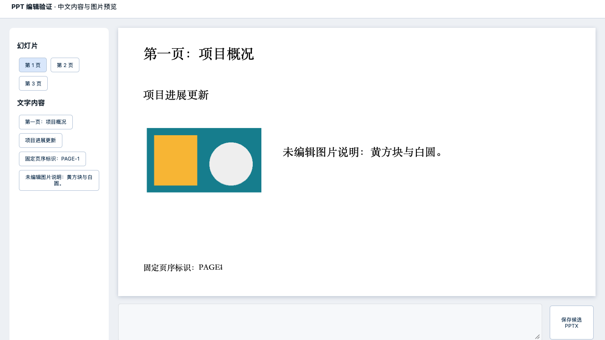
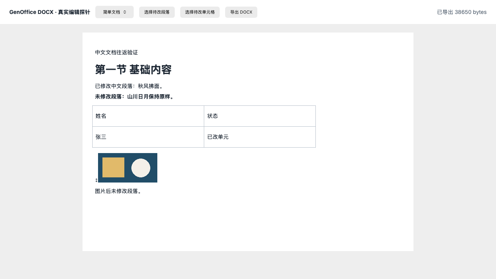
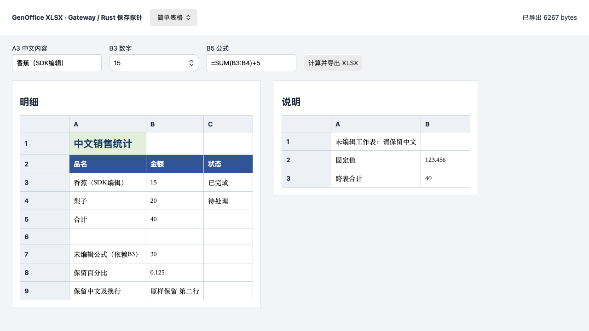

# Office 候选实际验证：Univer / GenOffice（2026-10-13）

## 工作包

- 关联：#118 / F03 Office 候选验证；前置调研见 [候选报告](office-integration-candidate-research-20261013.md)。
- 依赖：Univer Web SDK / Exchange 1.0.4、其声明的原生 binding、React 19、现有 File 字节读取与 CAS/版本服务。
- 本包交付：可复跑的三格式导入/小修改/导出验证、内容保留与外部工具重开结果，以及浏览器/主项目接入的实际结论。
- 非目标：本包不作为 F04/F05/F06 的完整格式功能交付，不关闭 #118；不引入通用插件平台或第二套版本存储。
- 用户指示：个人自用，本轮不以授权调查作为试验门槛。运行时是否要求许可仍按真实结果记录，不绕过检查或把不可用写成通过。
- 后续范围：用户不接受 PPT 水印后转验 GenOffice；随后要求对 Word、Excel 也比较 GenOffice，使用相同六份原件和编辑期望。新增 PDF、Markdown 的预览/简单编辑选型，分别记入专题报告。格式引擎、浏览器、外部重开与主项目接入边界分别判断。
- 验收：有效 DOCX/XLSX/PPTX 样本可导入；实际修改能导出并重开；明确核对中文、表格/公式/图片、页序及未改内容。浏览器编辑与引擎转换分开记录，主 File 保存能力与格式能力分开记录。
- 验证范围：隔离目录安装固定版本；Python Office 库生成受控样本，LibreOffice 无窗口核验；Node 格式试验及静默浏览器探针。需要桌面界面验收时提前告知、集中执行。
- 仓库状态：开工前已有 Agent/Overview/Voice 等其他改动；仅修改本包文件。未发现运行中的 `tauri dev` 自动重启进程，已有验收应用不由本包关闭或操作。

## 结果

**本轮对照更支持使用 GenOffice 的公开 Office 核心，按格式接入主程序。** Word/PPT 在相同样本上保留更好，且已实际显示无额外许可水印；Excel 保留样式与未改部件，但必须修正公式缓存保存路径。三格式都已有候选导出和浏览器探针，尚未作为主程序功能交付。

下面表格记录 Univer 对照结果，当前选型和 GenOffice 结果见后文；不是继续推荐三格式统一使用 Univer Exchange。

| 格式 | 实际编辑与导出 | 保留结果 | 选型判断 |
| --- | --- | --- | --- |
| XLSX | 中文、数字、SUM/依赖/跨表公式可修改；Chrome/WebKit 中文键盘输入和 Facade 保存生效 | FORCED 下受测数据语义通过；默认计算留过期缓存；浏览器键盘编辑后字体属性变化；作者/Company 被改写 | 适合首个主项目接入候选，字体与元数据问题处理后再验收 |
| DOCX | 段落、普通表格内容可修改；浏览器插入中文前缀并导出；WebKit 键盘中文及撤销生效 | Traditional 保留主要页面参数；Core 单独保存丢图片，补 Drawing preset 复测；部分缺省 XML 属性省略、作者/Company 改写 | 需要 Traditional + Core + Drawing，不能只装 Core；受限编辑候选 |
| PPTX | 独立文本框中文替换、PNG 位移、页序可保留；两浏览器 Facade 修改可导出 | 复杂样本备注/notes master 全丢、图表类型改写、模板动态字段及结构损失；编辑器明显水印 | 当前方案不接受，PPT 转验 GenOffice |

这些结论来自六份受控真实 Office 文件，不来自空白编辑器演示。原件 hash 在试验前后一致，候选另存。严格差异、等价重写与实际内容损失分别记录；保留原失败断言，不将所有 XML hash 差异叫作丢内容。

## 环境与可复跑产物

- 平台：macOS arm64；Node 24.19.0 / 26.8.1；Python 3.12.14，python-docx 1.2.0、openpyxl 3.1.5、python-pptx 1.0.2。
- Web / Exchange 固定 1.0.4；原生 binding 按发布包真实依赖为 1.0.2。React 19.2.0；Vite 8.0.3。
- 试验在隔离目录进行，没有改变根 package.json/package-lock 或主应用源码。安装使用 `--ignore-scripts`，darwin-arm64 原生 optional 包实际加载成功。
- [复跑说明](../../packages/office-validation/README.md)、[锁定依赖](../../packages/office-validation/package-lock.json)、[浏览器探针](../../packages/office-validation/browser/main.js)、[候选导出接口](../../packages/office-validation/vite.config.mjs)。
- 原始执行目录：`/tmp/project-mind-univer-validation-20261013`。归档只保留脚本、受控原件和精选证据，依赖与大快照不纳入仓库。

本机完整开发依赖约 466 MiB（补图片插件前一次测量）；它包含三个格式、开发工具和多种能力，**不是桌面发布增量**。主项目固定 Node 当前为 24.21.0；本轮未对该精确版本或 Windows 原生包、签名和发布布局验收。

隔离宿主的生产 bundle 构建也已实际通过：Vite 8.0.3，1,833 个模块，3.69 秒；三格式静态合并主 JS 约 18.65 MB（gzip 4.36 MB），CSS 150 KB。这个探针未做按格式懒加载，不能把它直接加入主项目首屏；数字只用于识别真实体积风险，不是最终桌面包体。

## 两种 Exchange API 的边界

1. `importFile/importBuffer` 返回产品内存模型：`IWorkbookData/IDocumentData/ISlideData`，供 Web SDK 创建 unit；Web `save()` 返回此类模型，再由 `exportToBuffer` 导出。
2. `importFileToSnapshot/importBufferToSnapshot` 返回完整 protocol aggregate `{snapshot,sheetBlocks}`，配对 `exportSnapshotToBuffer`。本轮用作无编辑对照，**不能拿 aggregate wrapper 当作 Web UI 产品快照**。

两种无编辑链均实跑；实际编辑覆盖产品模型链。Node 直接修改模型与 Web Facade/键盘编辑分别留证，不将它们互相替代。

## DOCX

两样本含中文标题/段落、2×2 表格、PNG；复杂样本加分节、分页、独立页眉页脚和外部链接。三种导入模式 × 两样本 × aggregate 无编辑、产品无编辑、产品编辑，共 18 条候选。

实际修改中文段落和一个表格单元格，SDK 再次导入与独立 python-docx/OOXML 核对生效；未改段落、标题、粗体、表格、PNG 字节与尺寸、分页、逐节页眉页脚和链接通过受测断言。

- **默认/Modern**：本输入下导入就改变了纸张尺寸和主要页边距。不能按默认 options 接入。
- **显式 Traditional**：纸张和主要边距保持；严格 16 项检查 15 项通过，仍失败的是 section 中 `gutter=0` 与 `cols space=720` 省略。省略 gutter 对本样本等价于零，但不推及多栏等未测内容。
- **浏览器 Core 单独配置**：段落编辑生效，但输出删除未编辑图片。这是 UI 保存链新增损失，Node 往返原本有图片。
- **补齐 `UniverDocsDrawingPreset`**：两引擎重新加载/编辑/保存，浏览器图片已实际显示；独立输出检查结果单独记录，不覆盖 Core 失败证据。官方图片功能要求 Core 与 Drawing 组合。[官方配置](https://docs.univer.ai/guides/docs/features/images)。

原始细项：[DOCX findings](../../packages/office-validation/evidence/docx/findings.md)。不推定修订、域、目录、脚注、合并表格、嵌入对象或目标系统 IME 已通过。

## XLSX

两份样本覆盖两张中文表、中文值、金额/百分比/小数格式、合并、行列尺寸、冻结窗格、SUM/依赖/跨表公式；复杂样本另含隐藏表、条件格式、中文列表验证、柱形图和 PNG。

Node 实际编辑 A3 文本、B3 数字、B5 公式；独立 openpyxl 分别按公式与缓存读取，另读图表/XML/media，再次 SDK 导入核对。

- **必须显式 FORCED 计算**：期望 B5=40、B7=30、跨表 B3=40；默认 WHEN_EMPTY 实测留下 B7=20、跨表=30 的过期缓存。
- 六条 FORCED 分支的受测数据语义通过；严格 simple 4/70、complex 7/84 项差异继续保留。差异涉及字体 family/空边框补全、条件格式 12→12.0、验证默认 stop、图表引用和数据缓存重写。独立语义检查核对这些属性和当前数据，没有发现本次覆盖的对象丢失。
- **浏览器新增字体变化**：键盘改 A3 后，原 Calibri 11 / minor / theme 颜色变成无显式字体字号与固定深色。不能把内容值正确当作字体保留；主接入前需要修正该真实路径并重测。
- 原作者改为 Univer.ai、Company 写入 Univer.ai，是引擎转换已有变化，需要纳入保存验收。

原始细项：[XLSX findings](../../packages/office-validation/evidence/xlsx/findings.md)。所测一个柱形图通过语义核对不能推定所有 Excel 图表/公式/宏可用。

## PPTX 与无水印要求

三页中文样本含独立文本框、PNG 和固定页序标记；复杂样本另有 3×3 表格、簇状柱状图/嵌入工作簿、每页备注与母版/版式。

- 基础文字替换、图片右移 18 points 实际导出生效；图片字节、未改文字/字号/几何与三页顺序通过核对。
- **无编辑往返也丢失**三页备注、notes master 及其主题；图表 clustered 改为 standard，独立 python-pptx 的 chart_type 解析报错。
- 母版/版式动态日期、页码域被改为普通提示文字，母版层级及部分未用版式语义改写。主主题与受测有效坐标保留；hash 不同并非都判内容损失。
- 浏览器可加载并通过 Facade 修改，但出现整页斜向 Univer Office 水印与 License Required 提示。官方文档把残留水印列为许可配置检查项。[官方说明](https://docs.univer.ai/server/license)。用户明确不接受水印，故当前配置不作为 PPT 主方案。
- 本次 PPT 画布双击后键盘输入未验证成功，只能确认 Facade 编辑。没有把它写成完整人工编辑验收。

原始细项：[PPTX findings](../../packages/office-validation/evidence/pptx/findings.md)。**PPT 技术路径可执行不等于本产品可接受。** GenOffice 的公开核心另验，未由源码许可或无水印声明推定实际效果。

## 浏览器与保存

Chrome 和 Playwright WebKit 26.6（build 2368）均在无窗口模式运行，React 19 容器分别挂载三种 SDK。两引擎共六个原格式导出候选由独立 Python 库/ZIP 再核对。

- Excel：界面地址框选 A3，键盘输入“键盘中文编辑”；Facade 改 A1 为“浏览器编辑”，两处实际值在导出 XLSX 中存在。
- Word：Facade 在首段插入“浏览器编辑：”，输出 DOCX 含预期内容；另在 WebKit 画布定位正文，键盘输入中文后读取模型确认，Meta+Z 恢复原文。
- PPT：Facade 首文本 run 替换，原格式输出含改文；其余页文字与图片保留，但已有模板/转换限制和界面水印仍成立。

Unicode 键盘输入 **不等于系统中文输入法 composition 验收**。Playwright WebKit **不等于 Tauri WKWebView**，Chrome **不等于 Windows WebView2**。本次截图确有中文表格、Word 段落/表格/图片和 PPT 图片/缩略图显示，不仅检查 unit 创建成功。

首次小样本已预加载 bundle 后，三种格式加载用时约 18–101 ms；Node cold import 约 0.37–0.48 秒。一次小样本测量不构成首屏、大文件或内存性能承诺。

浏览器候选通过 `active.save()` → 本地 Exchange 导出；原格式编辑检查通过但整体保留结果含失败，详见 [独立验证](../../packages/office-validation/evidence/browser/verification.md)。`save()` 本身没有写 Project File，也没有产生业务 File Version。

## 外部重开

LibreOfficeDev 26.8.0.0.alpha0 在 headless 模式外部重开：六原件、各格式 simple/complex 的无编辑与编辑候选、两浏览器各三格式，共 24 个当前文件；另保留修正前两份 DOCX 记录，共 26 条版本记录。全部返回零、PDF 可读且有页面；来源 hash 改变件数为零。

| 格式/样本 | 原件与 Node 候选 PDF 页数 | 无编辑全文（忽略空白） |
| --- | --- | --- |
| DOCX simple / complex（Traditional） | 1 / 3，均保持 | 相同 |
| XLSX simple / complex | 2 / 3，均保持 | 相同 |
| PPTX simple / complex | 3 / 3，均保持 | simple 相同；complex 不同 |

修正后的两引擎 DOCX 输出均 1 页、1 张图片，与原件页数/图片数对应。复杂 PPT 无编辑输出在外部 PDF 中不再包含图表标题“业务数量”，绘图区与配色也出现变化，与引擎保留失败一致。

工具自身对原件的部分中文渲染出现方框，不能据其截图宣称中文视觉保真。pypdf 抽取出现异常后，文字诊断使用 Poppler，原始证据保留。转换成功、同页数/文字也不代表像素外观或 Microsoft Office 兼容性通过。[外部重开记录](../../packages/office-validation/evidence/external/findings.md)。

## 主项目接入建议与交付边界

1. 主程序 Project File 页签挂载对应编辑器；继续使用已有 `projectFileApi.readBytes` 的固定 version/hash 原件。
2. Office 采用固定 GenOffice 公开核心：Word 保留原 ParsedDoc 和 PM 编辑模型；Excel 使用 OSS 表格 UI + Gateway/Rust sidecar，修正缓存表漏写；PPT 使用原件解析、RenderTree 与局部保存。需要 Node 的格式操作放入本地 worker；目标平台打包与前端宿主分别验证。Univer Exchange 对照的 Traditional/Drawing/FORCED 配置留作备选证据。
3. 新的 GUI 字节保存适配调用既有 FileContentService 的 staged/hash/CAS/原生版本提交；成功才更新基线，失败保留编辑。这部分尚未实现或执行。
4. DSH 文件工具与 GUI 共用 File ID/版本/hash、格式操作与提交，不复制 `.univer` 作为第二份正文存储。DSH 插件继续作为 Facade 调用参考。

当前源码接缝：`src/services/projectFileApi.ts` 有字节读取；`src/services/fileDocumentApi.ts` 有版本/原文/恢复；`src-tauri/src/file_content.rs` 有分块、hash、CAS 和新版本提交。现有 worker 未暴露 Office 方法，本轮没有为了探针扩大其白名单或运行用户项目文件。

**本包交付的是候选验证证据和可复跑探针。F04/F05/F06、真实主应用保存/历史恢复/外部变更冲突、Tauri 与 Windows、真实 DSH 接入均未交付；#118 保持开放。**

## 补充：GenOffice 无水印 PPTX 验证

因用户不接受 Univer PPT 水印，使用固定上游 `d32d1711f1bf985430757b8c6b3fbddd3831d946` 的公开 `pptx-engine`、`pptx-render` 核心，复用相同两份原件，独立运行无修改与“中文文字 + 图片位置”编辑对照。浏览器另做 React 19 薄宿主，把实际 RenderTree 的文字/图片画到 SVG，并用表单内容调用引擎编辑、保存和重开。

**Chrome 与 WebKit 的简单 PPT 预览没有水印，中文和 PNG 实际可见；表单修改“项目进展正常”→“项目进展更新”，导出的 PPTX 候选真实生成。** 下图是已编辑后 WebKit 的实际截图，不是效果图。

这个验证 UI 是我们的薄 SVG 适配，支持该简单样本的文字/图片，不是 GenOffice 完整应用 UI。字体布局目前使用上游 HeuristicMetrics，未注入真实字体度量；复杂图表/表格交互、画布直接文字编辑、连续编辑会话、撤销、主 File 回存未作为通过项。主应用接入可从这个受限范围实现，再按真实需求补充。

引擎与浏览器独立保存检查、嵌入部件差异及外部重开，见 [GenOffice 复跑与证据](../../packages/genoffice-pptx-validation/README.md)。PPT 路线按这些实际限制推进，不把“没有水印”单独当成文件保真通过。

### GenOffice PPTX 独立结果

- simple 无编辑与中文/图片位移编辑：独立检查通过；两个浏览器文字编辑候选各通过 50 项原格式检查。
- complex 无编辑与同样编辑：各 131 项语义检查通过，原 notes/chart/master/layout/theme/embedded XLSX 文件部件字节保留；与 Univer 备注和模板丢失有实际区别。
- complex 的原严格 embedding count 失败为 **2 vs 1**，新增的是零字节 `ppt/embeddings/` 目录项，并未增加嵌入文件；原嵌入工作簿仍由原图表 relationship 使用。保留严格失败，分类为容器差异。
- 无编辑全部实际文件部件字节一致，编辑只改 slide1.xml；ZIP 重装增加目录/改变压缩，simple 文件约增大 40%、complex 约 31%。因此不是整个文件字节恒等保存。
- `sp_*/pic_*` 的 SDK 原模型比较仍为 false，差异是进程局部临时 ID；追加只排除该字段的完整内容核对通过。长期对象定位不能直接使用该临时 ID。
- 八份外部重开记录（两个同 hash 原件复用，六候选实际转换）均成功、均三页，图片逐页为 [1,0,0]；complex 图表标题“业务数量”在原件和候选均存在。无编辑全文逐页相同，两种浏览器输出只改预期文字。工具中文字体限制仍保留。[GenOffice 外部结果](../../packages/office-validation/evidence/genoffice-external/findings.md)。

**本次受控 PPT 样本更支持 GenOffice 核心作为后续接入路线。** 公开核心引擎、薄宿主 UI 和实际 File 提交是三项工作；后两项的完整产品能力仍需实现，不能直接把完整 Electron 应用放入 Tauri。

## GenOffice Word / Excel 对比

同样六份原件，不用新造空白文件替代导入原文。固定 GenOffice SHA 与 PPT 相同。

### Word：优先 GenOffice core + Tiptap

- 真实 `parseDocx → blocksToPmDoc → pmDocToSavePlan → saveDocx`；另验证原 schema / EditorState 转换和真实 Tiptap Editor 的键盘输入，没有只用自造 XML 补丁。
- 引擎/schema 十组及 Chrome/WebKit 四组候选各 20 项独立检查通过。无改保存直接保留原包字节；编辑只改变正文和 modified/revision，原作者/Company、PNG 字节/几何、分节、页眉页脚、分页、链接和纸张参数保持。
- 薄宿主实际显示中文、表格和 PNG，选择目标后键盘替换段落/单元格；两浏览器、两样本共四候选保存后重开正确。没有额外许可水印。
- 外部重开十条记录全部成功，simple 1 页、complex 3 页；页数/尺寸相同，全文仅有预期替换。四条同 hash 原件/无改记录复用既有证据，六编辑候选实际转换。[外部证据](../../packages/office-validation/evidence/genoffice-docx-external/findings.md)。
- 完整分页、页眉页脚 UI、字体断行、合并表/修订/脚注和连续编辑会话未验收。图片在编辑期间保留，不代表已经支持图片移动。原文自带水印需保留，不能把文档水印与 SDK 许可叠层混为一谈。

[Word 复跑包与 findings](../../packages/genoffice-docx-validation/README.md)。原 ParsedDoc 中的 originalBytes、原块签名和锚点必须与当前编辑模型成对保留；成功提交后重新 parse/rebase，再进行下一轮编辑。

### Excel：GenOffice 保存引擎 + OSS 表格 UI，需修正缓存漏写

- 真正的 Node Gateway → mutation plan → Rust sidecar 原格式保存，未用自定义 ZIP 修改替代。前端源代码使用 Univer OSS，采用 GenOffice 不意味着换掉这个表格画布；关键变化是原件保存链。
- 无改保存的全部实际部件与未改压缩 payload 字节保持，ZIP 容器重组使整体 hash 改变，不能宣称整个文件字节相同。A3 中文、B3=15、B5=`=SUM(B3:B4)+5` 修改后，受测样式/元数据、隐藏表、冻结/合并/尺寸、条件格式/验证、图表/PNG与未改压缩部件保留。
- **headless Gateway 默认分支失败**：B5 无缓存，依赖 B7 和跨表 B3 仍是旧值。显式 IronCalc 算出正确 40/30/40，但默认保存只更新已编辑表，跨表缓存仍为 30。这是实际保存缺陷，保留失败输出。
- **限定修正验证通过**：使用公开 `writeValue:false` 编辑标记加载缓存专用表，使保存把算出的缓存写入；不改原公式与正文。后续接入应修正 Gateway 的表加载范围，覆盖 formulaValues 所指表，不依赖临时探针标记。需保留原公式、样式和未改单元格。
- Chrome/WebKit 的薄表格宿主分别填写三个输入，真实 Gateway 保存和 sidecar 重开；独立内容/样式检查 simple 各 70 项、complex 各 84 项通过；补齐元数据、压缩部件、XML 范围和 SDK 再读后分别为 80/80、94/94。这个 headless 分支不等于完整 GenOffice GUI 默认保存行为；上游 GUI 还有 OSS 画布实时计算路径，本轮未运行。UI 只画普通格子/部分样式；合并/冻结交互、图表图片展示及完整 GenOffice OSS UI 尚未在这个薄宿主验收。
- 外部工具可以重开失败缓存分支并自行重算，不能用其 PDF 结果覆盖原 XLSX 缓存失败。[外部证据](../../packages/office-validation/evidence/genoffice-xlsx-external/findings.md)。

[Excel 复跑包与 findings](../../packages/genoffice-xlsx-validation/README.md)。公式范围仅覆盖受测 SUM、依赖与跨表，不能推及全部 Excel 函数、外部链接、宏或大型模型。

## PDF / Markdown 扩展

用户新增这两种格式的选型。它们仍接同一 Project File 与版本/CAS 服务；不将 Office 引擎成功推及 PDF 原文编辑或 Markdown 富文本无损往返。

- **Markdown**：建议直接补源码编辑，复用现有 GFM/资源预览，需要专业源码交互时选 CodeMirror 6。现有 parser/React SSR、六种原字节样本和安全预览共 31 项断言通过；未测 GUI/IME/CAS。GenOffice 源 helper 会归一混合换行，完整 Tiptap/source-map 不作为任意源码字节保留保证；现有重复图片引用取后定义的差异在 F02 接入前需修正。[专题报告](markdown-integration-candidate-research-20261013.md)。
- **PDF**：继续复用既有 PDF.js 预览，表单/批注与原文字修改分开选择。英文表单两库各两样本往返通过；中文默认字段字体失败，白矩形覆盖保留原文字，不能称原文编辑。GenOffice PDFium WASM core 已实跑英文/中文原文替换，旧目标消失、新目标出现，受测未改正文、图片、链接/表单/第二页保留；中文 PNG 主 agent 已查看。英文新字形超出原目标框约 4px 的严格像素差异保持 limited，字体依赖和最终 private save 校验仍需接入，最新结论见 [专题报告](pdf-integration-candidate-research-20261013.md)。
